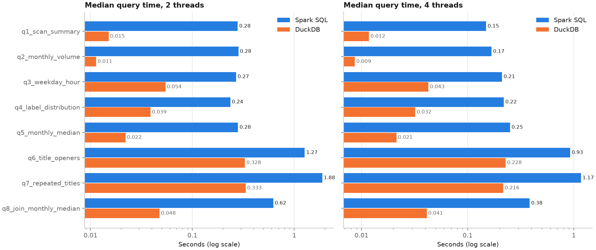

# Benchmark Spark SQL và DuckDB

Hai engine chạy **cùng một đoạn SQL** (thư mục `benchmarks/queries/`) trên **cùng bộ Parquet đã làm sạch**, với số luồng bằng nhau trong từng cấu hình. Không engine nào cache dữ liệu hay kết quả; mỗi lần chạy đều đọc lại Parquet (page cache của hệ điều hành đã ấm sau 1 lần chạy khởi động). Mỗi truy vấn được đo 5 lần; bảng báo cáo median. Thời gian gồm lập kế hoạch, thực thi và lấy kết quả về Python; không gồm thời gian khởi động engine.

**Kết quả hai engine khớp nhau ở mọi truy vấn: có.** Đối chiếu `q4_label_distribution` với `reports/experiments/fang_chua_20261121_v1/class_distributions.json`: khớp.

## Môi trường

| Thành phần | Giá trị |
| --- | ---: |
| CPU | 11th Gen Intel(R) Core(TM) i7-1165G7 @ 2.80GHz |
| Số CPU logic (WSL) | 8 |
| RAM (WSL) | 8001752 kB |
| Hệ điều hành | Linux-6.6.87.2-microsoft-standard-WSL2-x86_64-with-glibc2.44 |
| Python | 3.14.8 |
| Java | openjdk version "21.0.12.1" 2026-08-18 |
| Spark | 4.3.0 |
| DuckDB | 1.5.4 |
| Dữ liệu | 12 file Parquet, 54.2 MiB, 1,686,985 bài |

## Thời gian (giây, median)



| Luồng | Truy vấn | Spark | DuckDB | Spark / DuckDB | Khớp |
| --- | ---: | ---: | ---: | ---: | ---: |
| 2 | q1_scan_summary | 0.279 | 0.0151 | 18.5× | có |
| 2 | q2_monthly_volume | 0.284 | 0.0114 | 25.0× | có |
| 2 | q3_weekday_hour | 0.269 | 0.0544 | 4.9× | có |
| 2 | q4_label_distribution | 0.236 | 0.0388 | 6.1× | có |
| 2 | q5_monthly_median | 0.281 | 0.0221 | 12.7× | có |
| 2 | q6_title_openers | 1.269 | 0.3282 | 3.9× | có |
| 2 | q7_repeated_titles | 1.884 | 0.3334 | 5.7× | có |
| 2 | q8_join_monthly_median | 0.623 | 0.0477 | 13.1× | có |
| 4 | q1_scan_summary | 0.149 | 0.0118 | 12.7× | có |
| 4 | q2_monthly_volume | 0.168 | 0.0087 | 19.4× | có |
| 4 | q3_weekday_hour | 0.211 | 0.0428 | 4.9× | có |
| 4 | q4_label_distribution | 0.220 | 0.0321 | 6.8× | có |
| 4 | q5_monthly_median | 0.251 | 0.0214 | 11.7× | có |
| 4 | q6_title_openers | 0.925 | 0.2278 | 4.1× | có |
| 4 | q7_repeated_titles | 1.170 | 0.2165 | 5.4× | có |
| 4 | q8_join_monthly_median | 0.384 | 0.0413 | 9.3× | có |

Thời gian khởi động engine (giây): 2 luồng — Spark 7.0, DuckDB 0.009; 4 luồng — Spark 0.2, DuckDB 0.028. Cấu hình Spark thứ hai tái sử dụng JVM đã khởi động (PySpark giữ tiến trình JVM sau `spark.stop()`), nên chỉ đo thời gian tạo SparkContext mới; con số của cấu hình đầu tiên mới phản ánh chi phí khởi động đầy đủ.

## Diễn giải

- Đây là phép đo trên **một máy, Spark ở chế độ local**. Kết quả không mô tả hiệu năng của Spark trên cụm nhiều máy.
- Dữ liệu (~55 MiB nén, 1,7 triệu dòng) vừa trong RAM của một máy. Ở quy mô này, chi phí cố định của Spark (lập kế hoạch, lên lịch task, JVM, shuffle) chiếm phần lớn thời gian; DuckDB là engine nhúng, vector hóa, không có chi phí đó.
- Spark có lợi thế khi dữ liệu vượt quá bộ nhớ một máy, khi cần chạy phân tán, chịu lỗi, hoặc tích hợp MLlib — như pipeline huấn luyện của dự án. DuckDB phù hợp cho truy vấn tương tác và dashboard trên dữ liệu đã thu gọn.
- Các truy vấn được viết bằng SQL chung cho cả hai dialect (ví dụ tính giờ/thứ bằng số học trên `created_utc`), nên không dùng hàm đặc thù có thể nhanh hơn trên từng engine.

## Tái lập

```bash
JAVA_HOME=/usr/lib/jvm/java-21-openjdk SPARK_LOCAL_IP=127.0.0.1 PYTHONPATH=src \
  .venv/bin/python -m askreddit.benchmark --threads 2 4 --run-id <run-id-mới>
```
