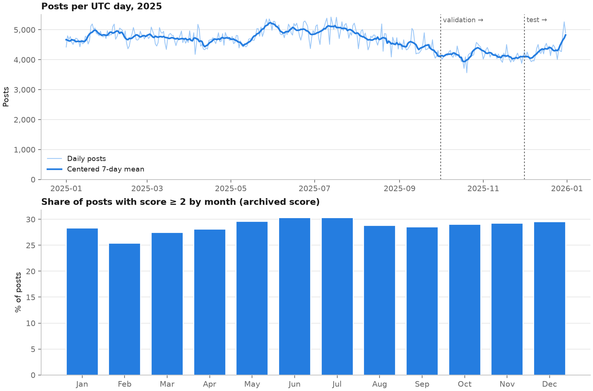
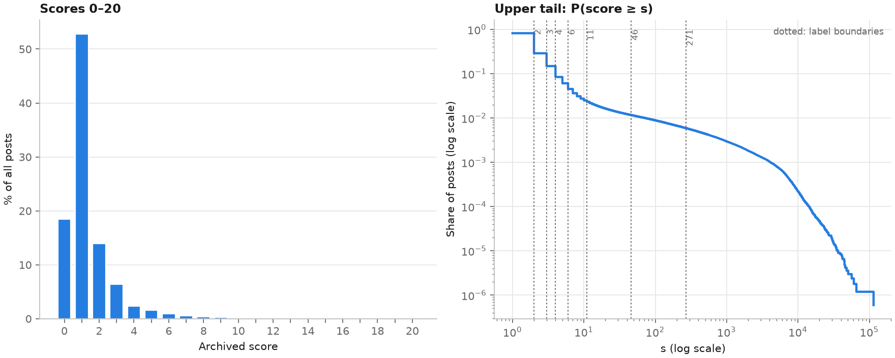
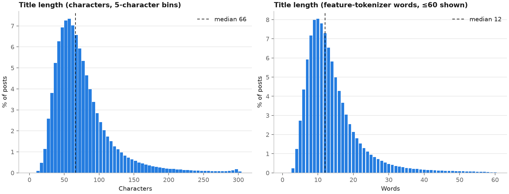
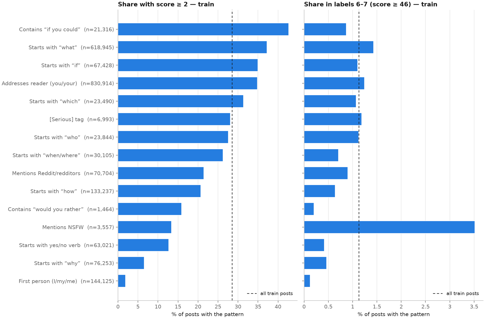
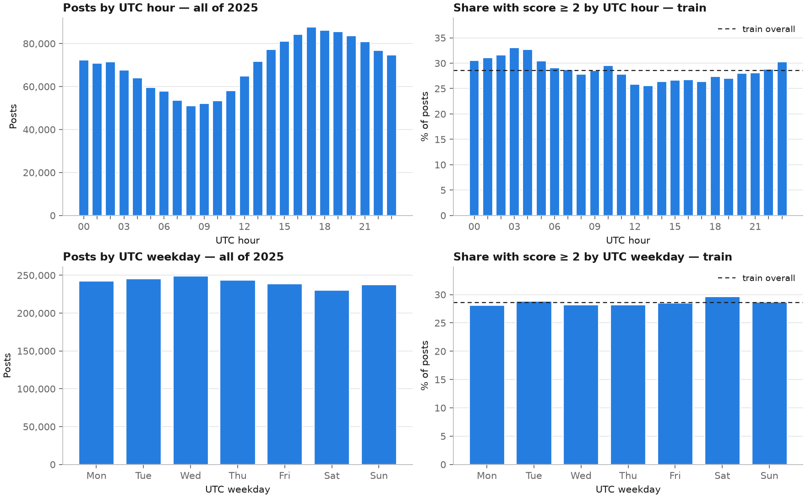
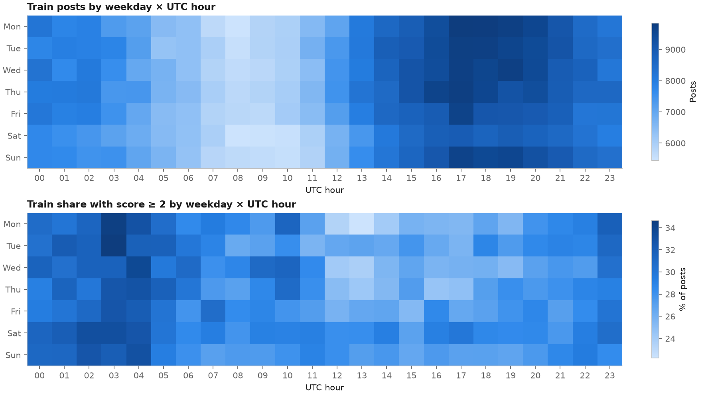
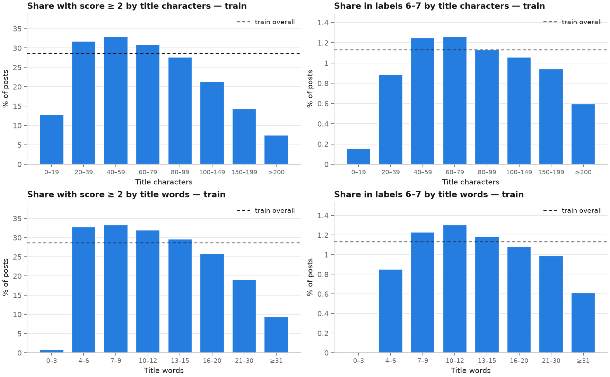
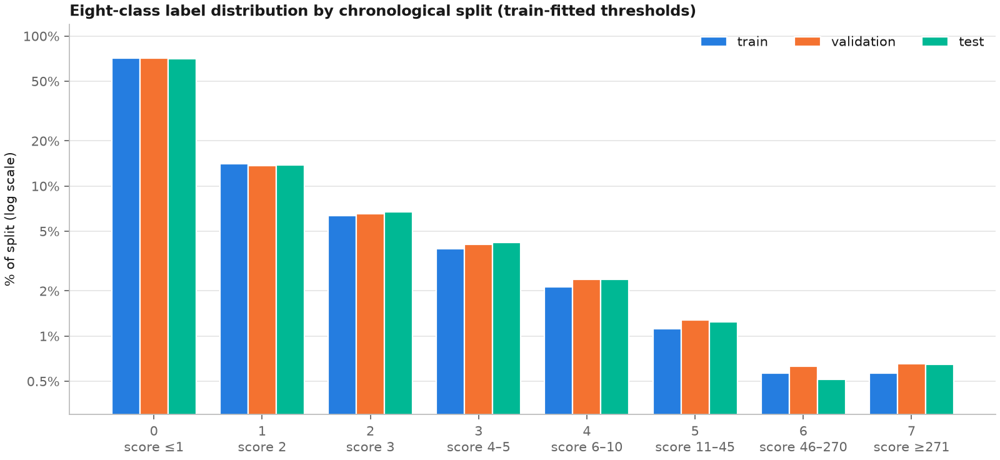

# Phân tích khám phá dữ liệu (EDA) — r/AskReddit 2025

Báo cáo này được sinh tự động bằng `python -m askreddit.eda` từ các file JSON cùng thư mục. Spark tính mọi số liệu trên toàn bộ **1,686,985** bài đã làm sạch (thời gian chạy 142 giây, Spark 4.3.0).

**Phạm vi:** các bảng khối lượng, độ phủ và phân phối score mô tả cả năm 2025. Các phân tích *liên hệ* giữa đặc điểm tiêu đề, thời điểm đăng và độ phổ biến chỉ dùng **tập train** (01/01/2025 – 30/09/2025 UTC), để validation và test không ảnh hưởng tới quyết định mô hình. Đây là quan hệ mô tả, **không phải quan hệ nhân quả**. Score là giá trị lưu trong archive, không phải score sau một khoảng thời gian cố định.

Hai thước đo độ phổ biến dùng xuyên suốt: **tỉ lệ score ≥ 2** (nhãn ≥ 1) và **tỉ lệ nhãn 6–7** (score ≥ 46, khoảng 1% bài phổ biến nhất).

## Nhận xét chính

- **Score rất lệch:** 71.27% bài có score ≤ 1, median 1, p99 = 69, max = 114,515. Accuracy vì vậy không phải thước đo phù hợp.
- **Từ ngữ của tiêu đề liên hệ rõ nhất với độ phổ biến (train):** mẫu tốt nhất là Chứa “if you could” (42.67% có score ≥ 2, lift 1.49); kém nhất là Ngôi thứ nhất (I/my/me) (1.91%, lift 0.07), so với 28.57% toàn train. Tiêu đề không có dấu hỏi chỉ đạt 0.97%.
- **Giả thuyết (chưa kiểm chứng):** các mẫu kém nhất trùng với quy định của r/AskReddit (không hỏi lời khuyên cá nhân, tiêu đề phải là câu hỏi), nên score lưu trữ có thể phản ánh cả việc bài bị gỡ, không chỉ mức quan tâm của người đọc.
- **Thời điểm đăng chỉ liên hệ yếu:** theo giờ UTC, tỉ lệ score ≥ 2 dao động từ 25.56% (13:00) đến 33.02% (03:00), ngược chiều với lượng bài; theo thứ chỉ từ 28.11% đến 29.60%.
- **Tương quan đơn biến yếu:** Spearman với score từ -0.097 đến -0.066.
- **Nhãn tám lớp khả thi nhưng mong manh:** mọi lớp đều khác rỗng; lớp 1 (score = 2) tồn tại chỉ vì 49.1% bài score ≥ 2 có score đúng bằng 2 (ngưỡng là 50%).


## 1. Hồ sơ dữ liệu

- Số bài: **1,686,985**; ID duy nhất (1,686,985 ID khác nhau).
- Thời gian phủ (UTC): 2025-01-01T00:00:07+00:00 → 2025-12-31T23:59:25+00:00.
- Giá trị null: không có ở cột nào. Tiêu đề rỗng: 0.
- Score từ 0 đến 114,515.
- Bài chỉ có tiêu đề (selftext rỗng): **1,686,982** (99.9998%); chỉ 3 bài có nội dung vì r/AskReddit không cho phép nội dung bài.
- Tiêu đề chuẩn hóa khác nhau: 1,565,523; 173,707 bài (10.30%) có tiêu đề xuất hiện hơn một lần; tiêu đề lặp nhiều nhất xuất hiện 520 lần.

Schema: `id` (string), `subreddit` (string), `title` (string), `selftext` (string), `created_utc` (bigint), `score` (bigint), `year` (int), `month` (int).

Năm tiêu đề chuẩn hóa lặp lại nhiều nhất:

| Tiêu đề chuẩn hóa | Số bài |
| --- | ---: |
| `what should i do?` | 520 |
| `[ removed by moderator ]` | 486 |
| `what’s a small decision you made that completely changed your life?` | 437 |
| `what makes you happy?` | 260 |
| `how was your day?` | 206 |

## 2. Khối lượng bài theo thời gian



Trung bình **4,622** bài/ngày (median 4,648, thấp nhất 3,564, cao nhất 5,423). Tháng nhiều bài nhất là 07/2025 (156,011 bài), ít nhất là 11/2025 (123,601 bài). Đủ 12 tháng, 365 ngày có dữ liệu.

| Tháng | Số bài | Bài/ngày | % score ≤ 1 | % score ≥ 2 | % nhãn 6–7 | Median score | % chỉ tiêu đề |
| --- | ---: | ---: | ---: | ---: | ---: | ---: | ---: |
| 01/2025 | 147,226 | 4,749 | 71.70% | 28.30% | 1.15% | 1.00 | 100.00% |
| 02/2025 | 134,902 | 4,818 | 74.64% | 25.36% | 1.02% | 1.00 | 100.00% |
| 03/2025 | 146,729 | 4,733 | 72.57% | 27.43% | 1.02% | 1.00 | 100.00% |
| 04/2025 | 139,575 | 4,652 | 71.90% | 28.10% | 1.12% | 1.00 | 100.00% |
| 05/2025 | 148,542 | 4,792 | 70.39% | 29.61% | 1.11% | 1.00 | 100.00% |
| 06/2025 | 149,575 | 4,986 | 69.73% | 30.27% | 1.20% | 1.00 | 100.00% |
| 07/2025 | 156,011 | 5,033 | 69.68% | 30.32% | 1.17% | 1.00 | 100.00% |
| 08/2025 | 144,569 | 4,664 | 71.22% | 28.78% | 1.16% | 1.00 | 100.00% |
| 09/2025 | 132,726 | 4,424 | 71.46% | 28.54% | 1.22% | 1.00 | 100.00% |
| 10/2025 | 129,424 | 4,175 | 70.95% | 29.05% | 1.31% | 1.00 | 100.00% |
| 11/2025 | 123,601 | 4,120 | 70.76% | 29.24% | 1.26% | 1.00 | 100.00% |
| 12/2025 | 134,105 | 4,326 | 70.46% | 29.54% | 1.16% | 1.00 | 100.00% |

Cột độ phổ biến của tháng 10–12 chỉ để mô tả; không dùng cho quyết định mô hình.

## 3. Phân phối score



Score tập trung rất mạnh ở giá trị thấp: score = 0 chiếm **18.45%**, score = 1 chiếm **52.82%**, tổng cộng **71.27%** bài có score ≤ 1. Đồng thời đuôi trên rất dài: giá trị lớn nhất là 114,515, có 4,353 giá trị score khác nhau, và trung bình (16.47) lớn hơn nhiều so với median (1). Vì vậy accuracy không phù hợp làm thước đo chính, và các ngưỡng nhãn cần dựa trên phân vị thay vì khoảng đều.

| Phân vị | p1 | p5 | p10 | p25 | p50 | p75 | p90 | p95 | p99 | p99.9 |
| --- | ---: | ---: | ---: | ---: | ---: | ---: | ---: | ---: | ---: | ---: |
| Score (cả năm) | 0 | 0 | 0 | 1 | 1 | 2 | 3 | 5 | 69 | 4093 |

| Score ≥ | Số bài | Tỉ lệ |
| --- | ---: | ---: |
| 2 | 484,731 | 28.734% |
| 10 | 41,858 | 2.481% |
| 46 | 19,493 | 1.155% |
| 100 | 14,823 | 0.879% |
| 271 | 9,869 | 0.585% |
| 1,000 | 4,970 | 0.295% |
| 10,000 | 372 | 0.022% |
| 100,000 | 1 | 0.000% |

Theo split (định nghĩa phân vị: nghịch đảo hàm phân phối thực nghiệm, chính xác):

| Split | Số bài | % score ≤ 1 | Median | p90 | p99 | Max |
| --- | ---: | ---: | ---: | ---: | ---: | ---: |
| test | 134,105 | 70.46% | 1 | 3 | 69 | 25,018 |
| train | 1,299,855 | 71.43% | 1 | 3 | 66 | 114,515 |
| validation | 253,025 | 70.86% | 1 | 3 | 89 | 44,325 |

## 4. Đặc điểm tiêu đề



Tiêu đề có median **66 ký tự** (p5–p95: 31–158) và **12 từ** (p5–p95: 6–29). **99.89%** tiêu đề có dấu hỏi. Các định nghĩa giống hệt đặc trưng của mô hình (NFKC, gộp khoảng trắng, tokenizer của mô hình).

Bảng mẫu câu hỏi trên tập train (toàn bộ train: 28.57% có score ≥ 2, 1.13% thuộc nhãn 6–7). *Lift* = tỉ lệ của nhóm / tỉ lệ toàn train; các mẫu có thể chồng lên nhau.

| Mẫu | Số bài train | % train | % score ≥ 2 | Lift | % nhãn 6–7 | Lift | Median score |
| --- | ---: | ---: | ---: | ---: | ---: | ---: | ---: |
| Chứa “if you could” | 21,316 | 1.64% | 42.67% | 1.49 | 0.87% | 0.77 | 1.00 |
| Bắt đầu bằng “what” | 618,945 | 47.62% | 37.23% | 1.30 | 1.43% | 1.27 | 1.00 |
| Bắt đầu bằng “if” | 67,428 | 5.19% | 35.00% | 1.22 | 1.10% | 0.98 | 1.00 |
| Nói với người đọc (you/your) | 830,914 | 63.92% | 34.85% | 1.22 | 1.24% | 1.10 | 1.00 |
| Bắt đầu bằng “which” | 23,490 | 1.81% | 31.39% | 1.10 | 1.07% | 0.95 | 1.00 |
| Thẻ [Serious] | 6,993 | 0.54% | 28.11% | 0.98 | 1.19% | 1.05 | 1.00 |
| Bắt đầu bằng “who” | 23,844 | 1.83% | 27.58% | 0.97 | 1.12% | 0.99 | 1.00 |
| Bắt đầu bằng “when/where” | 30,105 | 2.32% | 26.29% | 0.92 | 0.71% | 0.63 | 1.00 |
| Nhắc tới Reddit/redditors | 70,704 | 5.44% | 21.50% | 0.75 | 0.90% | 0.80 | 1.00 |
| Bắt đầu bằng “how” | 133,237 | 10.25% | 20.74% | 0.73 | 0.64% | 0.57 | 1.00 |
| Chứa “would you rather” | 1,464 | 0.11% | 15.92% | 0.56 | 0.20% | 0.18 | 1.00 |
| Nhắc tới NSFW | 3,557 | 0.27% | 13.41% | 0.47 | 3.51% | 3.11 | 1.00 |
| Bắt đầu bằng động từ câu hỏi có/không | 63,021 | 4.85% | 12.69% | 0.44 | 0.42% | 0.37 | 1.00 |
| Bắt đầu bằng “why” | 76,253 | 5.87% | 6.56% | 0.23 | 0.46% | 0.41 | 1.00 |
| Ngôi thứ nhất (I/my/me) | 144,125 | 11.09% | 1.91% | 0.07 | 0.13% | 0.11 | 1.00 |



## 5. Thời điểm đăng (UTC)





Cả năm, giờ có nhiều bài nhất là **17:00 UTC** (87,649 bài), ít nhất là **08:00 UTC** (51,110 bài). Trên train, tỉ lệ score ≥ 2 cao nhất lúc **03:00** (33.02%) và thấp nhất lúc **13:00** (25.56%). Giờ Việt Nam = giờ UTC + 7. Phần lớn người dùng Reddit ở Bắc Mỹ (UTC−5 đến UTC−8), nên khi diễn giải cần quy đổi khung giờ UTC sang các múi giờ đó.

| Thứ | Số bài cả năm | Số bài train | % score ≥ 2 | % nhãn 6–7 | Median score |
| --- | ---: | ---: | ---: | ---: | ---: |
| Mon | 242,592 | 187,472 | 28.11% | 1.12% | 1.00 |
| Tue | 245,413 | 188,804 | 28.81% | 1.15% | 1.00 |
| Wed | 248,873 | 188,466 | 28.20% | 1.11% | 1.00 |
| Thu | 243,518 | 189,466 | 28.21% | 1.14% | 1.00 |
| Fri | 238,654 | 184,860 | 28.48% | 1.11% | 1.00 |
| Sat | 230,450 | 177,617 | 29.60% | 1.16% | 1.00 |
| Sun | 237,485 | 183,170 | 28.66% | 1.11% | 1.00 |

## 6. Liên hệ giữa đặc điểm và độ phổ biến (train)



**Độ dài tiêu đề (ký tự)**

| Nhóm | Số bài | % score ≥ 2 | % nhãn 6–7 | Nhãn TB | Median score |
| --- | ---: | ---: | ---: | ---: | ---: |
| 0–19 | 7,624 | 12.78% | 0.16% | 0.257 | 1.00 |
| 20–39 | 166,211 | 31.72% | 0.89% | 0.687 | 1.00 |
| 40–59 | 360,033 | 33.00% | 1.25% | 0.706 | 1.00 |
| 60–79 | 321,095 | 30.95% | 1.26% | 0.642 | 1.00 |
| 80–99 | 193,626 | 27.65% | 1.13% | 0.554 | 1.00 |
| 100–149 | 172,597 | 21.37% | 1.06% | 0.424 | 1.00 |
| 150–199 | 46,638 | 14.31% | 0.94% | 0.287 | 1.00 |
| ≥200 | 32,031 | 7.50% | 0.60% | 0.154 | 1.00 |

**Độ dài tiêu đề (từ)**

| Nhóm | Số bài | % score ≥ 2 | % nhãn 6–7 | Nhãn TB | Median score |
| --- | ---: | ---: | ---: | ---: | ---: |
| 0–3 | 3,047 | 0.79% | 0.00% | 0.011 | 1.00 |
| 4–6 | 108,201 | 32.73% | 0.85% | 0.707 | 1.00 |
| 7–9 | 272,626 | 33.31% | 1.23% | 0.715 | 1.00 |
| 10–12 | 298,927 | 31.96% | 1.30% | 0.675 | 1.00 |
| 13–15 | 225,935 | 29.57% | 1.19% | 0.606 | 1.00 |
| 16–20 | 204,378 | 25.84% | 1.08% | 0.514 | 1.00 |
| 21–30 | 129,073 | 19.04% | 0.99% | 0.377 | 1.00 |
| ≥31 | 57,668 | 9.38% | 0.61% | 0.187 | 1.00 |

**Số dấu hỏi**

| Nhóm | Số bài | % score ≥ 2 | % nhãn 6–7 | Nhãn TB | Median score |
| --- | ---: | ---: | ---: | ---: | ---: |
| 0 | 1,541 | 0.97% | 0.06% | 0.020 | 1.00 |
| 1 | 1,177,536 | 29.70% | 1.19% | 0.623 | 1.00 |
| ≥2 | 120,778 | 17.88% | 0.58% | 0.342 | 1.00 |

**Có nội dung hay chỉ có tiêu đề:** chỉ 3 bài train có selftext (r/AskReddit không cho phép nội dung bài), nên không so sánh nhóm này; selftext gần như không mang thông tin.

**Tỉ lệ chữ hoa trên chữ cái**

| Nhóm | Số bài | % score ≥ 2 | % nhãn 6–7 | Nhãn TB | Median score |
| --- | ---: | ---: | ---: | ---: | ---: |
| 0.00–0.05 | 1,068,999 | 31.18% | 1.20% | 0.651 | 1.00 |
| 0.05–0.10 | 170,401 | 17.50% | 0.84% | 0.364 | 1.00 |
| 0.10–0.20 | 48,096 | 13.95% | 0.70% | 0.276 | 1.00 |
| 0.20–0.50 | 10,897 | 14.26% | 0.60% | 0.295 | 1.00 |
| ≥0.50 | 1,462 | 1.71% | 0.00% | 0.024 | 1.00 |

**Tương quan với score (train)**

| Đặc trưng | Spearman với score | Pearson với log(1+score) |
| --- | ---: | ---: |
| question_count | -0.0662 | -0.0520 |
| title_characters | -0.0791 | -0.0602 |
| title_words | -0.0850 | -0.0641 |
| uppercase_ratio | -0.0972 | -0.0564 |

Các hệ số tương quan đơn biến đều nhỏ (|ρ| < 0,1) và cùng âm: tiêu đề dài hơn, nhiều dấu hỏi hơn hoặc nhiều chữ hoa hơn đi kèm score hơi thấp hơn. Không có đặc trưng đơn lẻ nào giải thích được nhiều về score; tín hiệu dự đoán, nếu có, nằm ở từ ngữ cụ thể (xem bảng mẫu câu hỏi) và mức độ yếu này phù hợp với kết quả mô hình.

## 7. Mức sẵn sàng của nhãn tám lớp



Ngưỡng fit trên train bằng quy trình median phần dư phía trên (Fang và cộng sự, 2016): median chính xác **3, 4, 6, 11, 46, 271**, biên nguyên **[2, 3, 4, 6, 11, 46, 271]**. Mọi lớp đều khác rỗng ở cả ba split: **có**.

| Nhãn | Score | Train | Validation | Test |
| --- | ---: | ---: | ---: | ---: |
| 0 | ≤1 | 928,466 (71.43%) | 179,296 (70.86%) | 94,492 (70.46%) |
| 1 | 2 | 182,480 (14.04%) | 34,430 (13.61%) | 18,525 (13.81%) |
| 2 | 3 | 82,444 (6.34%) | 16,447 (6.50%) | 9,045 (6.74%) |
| 3 | 4–5 | 49,591 (3.82%) | 10,345 (4.09%) | 5,617 (4.19%) |
| 4 | 6–10 | 27,703 (2.13%) | 6,019 (2.38%) | 3,207 (2.39%) |
| 5 | 11–45 | 14,487 (1.11%) | 3,236 (1.28%) | 1,662 (1.24%) |
| 6 | 46–270 | 7,339 (0.56%) | 1,595 (0.63%) | 690 (0.51%) |
| 7 | ≥271 | 7,345 (0.57%) | 1,657 (0.65%) | 867 (0.65%) |

Số bài train có score đúng bằng một biên (luôn vào lớp cao hơn; các score bằng nhau không bao giờ bị tách):

| Biên | Số bài train tại biên | Nhãn nhận |
| --- | ---: | ---: |
| 2 | 182,480 | 1 |
| 3 | 82,444 | 2 |
| 4 | 29,803 | 3 |
| 6 | 11,282 | 4 |
| 11 | 1,874 | 5 |
| 46 | 109 | 6 |
| 271 | 9 | 7 |

Độ ổn định: fit lại cùng quy trình trên từng tháng train (chỉ để chẩn đoán, không phải ánh xạ dùng cho mô hình). Bước chia đầu tiên chỉ tạo được lớp 1 khi **dưới một nửa** số bài có score ≥ 2 có score đúng bằng 2; nếu không, median = 2 và lớp 1 rỗng (quy trình báo lỗi thay vì tạo lớp rỗng).

| Tháng | Biên fit riêng tháng | % score = 2 trong các bài score ≥ 2 |
| --- | ---: | ---: |
| 01/2025 | thoái hóa: median phần dư = 2, lớp 1 rỗng | 50.7% |
| 02/2025 | thoái hóa: median phần dư = 2, lớp 1 rỗng | 52.8% |
| 03/2025 | thoái hóa: median phần dư = 2, lớp 1 rỗng | 50.1% |
| 04/2025 | thoái hóa: median phần dư = 2, lớp 1 rỗng | 51.1% |
| 05/2025 | [2, 3, 4, 6, 11, 38, 212] | 48.5% |
| 06/2025 | [2, 3, 4, 6, 10, 34, 194] | 47.0% |
| 07/2025 | [2, 3, 4, 6, 11, 40, 249] | 47.2% |
| 08/2025 | [2, 3, 4, 6, 11, 44, 273] | 48.7% |
| 09/2025 | [2, 3, 4, 6, 11, 46, 333] | 47.2% |

Gộp cả giai đoạn train, tỉ lệ này là **49.1%** — chỉ vừa dưới 50%, nên median đầu tiên bằng 3 và lớp 1 = {score 2} tồn tại. Biên đầu (2, 3, 4, 6, 11) ổn định giữa các tháng; hai biên trên (46, 271) dao động theo tháng. Đây là điểm cần nêu khi trình bày: ánh xạ nhãn phụ thuộc giai đoạn fit.

Baseline luôn dự đoán lớp 0 (tính giải tích từ số lượng lớp):

| Split | Accuracy | Macro-F1 | Balanced accuracy |
| --- | ---: | ---: | ---: |
| test | 70.46% | 0.1033 | 0.125 |
| train | 71.43% | 0.1042 | 0.125 |
| validation | 70.86% | 0.1037 | 0.125 |

## 8. Giới hạn diễn giải

- Score là giá trị lưu trong archive tại thời điểm thu thập; không có thời điểm quan sát thống nhất cho mọi bài.
- Mọi liên hệ là mô tả, không kiểm soát các yếu tố khác (chủ đề, tác giả, lượng người online). Không suy ra rằng đổi tiêu đề hay giờ đăng sẽ làm bài phổ biến hơn.
- Các mẫu câu hỏi được nhận diện bằng biểu thức chính quy đơn giản trên tiêu đề viết thường và có thể chồng lên nhau.
- Giờ và thứ tính theo UTC; người dùng ở các múi giờ khác nhau trải nghiệm cùng một giờ UTC khác nhau.
- Phân tích liên hệ chỉ dùng train; validation/test chỉ xuất hiện trong bảng khối lượng, phân phối score và số lượng nhãn.

## Tái lập

```bash
JAVA_HOME=/usr/lib/jvm/java-21-openjdk SPARK_LOCAL_IP=127.0.0.1 PYTHONPATH=src \
  .venv/bin/python -m askreddit.eda --config configs/fang_chua_v2.json --output reports/eda_reproduction

# Chỉ vẽ lại hình và báo cáo từ JSON đã lưu (không cần Spark):
PYTHONPATH=src .venv/bin/python -m askreddit.eda --render-only --output reports/eda
```
