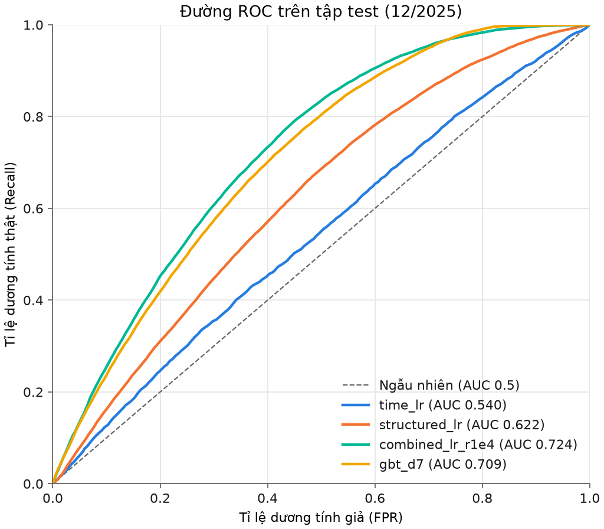
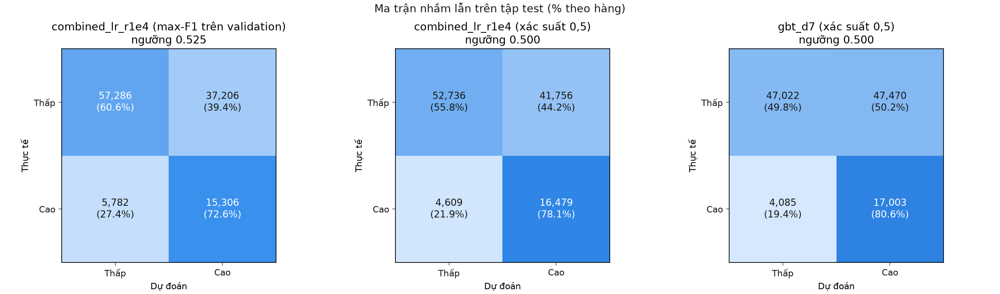
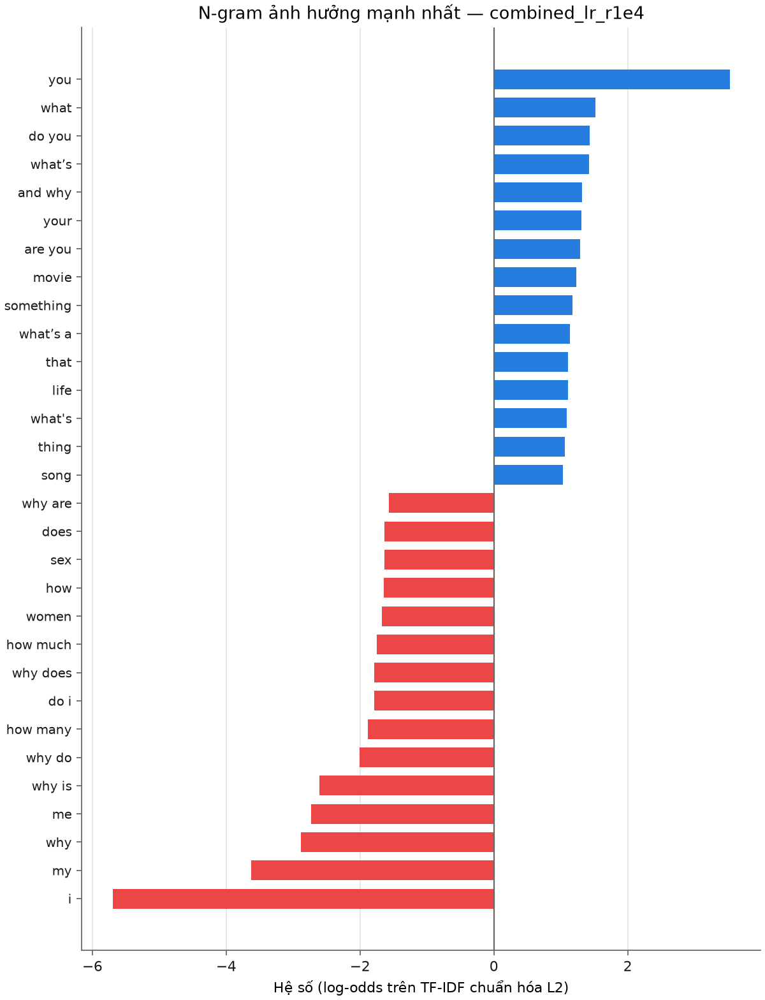
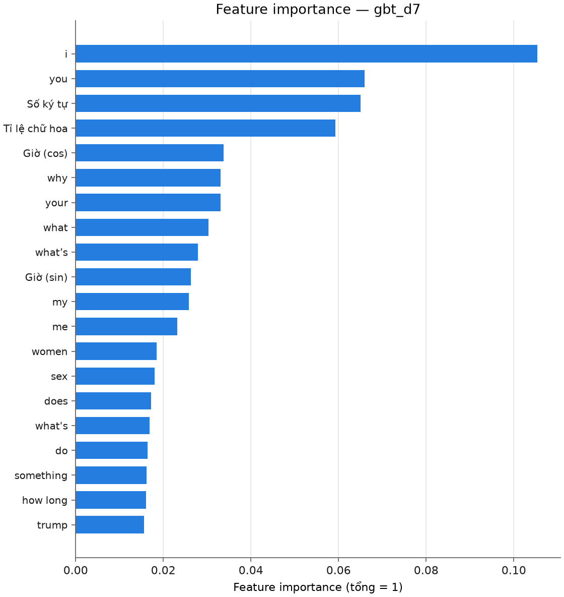
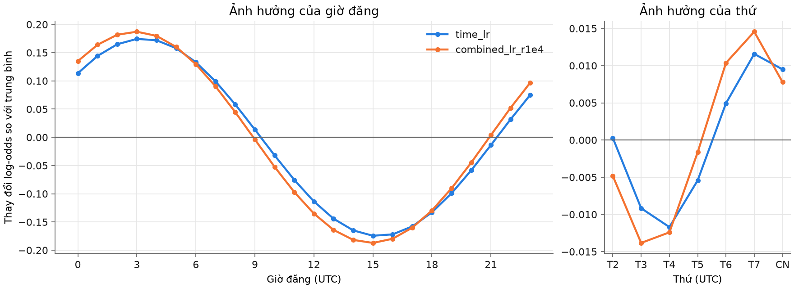

# Kết quả bài toán nhị phân — run `binary_20261125_v3`

Báo cáo sinh tự động bằng `python -m askreddit.binary_report` từ các file JSON cùng thư mục.

> **Công bố:** Cấu hình v3 thiết kế ngày 2026-11-25 để thực hiện bài toán nhị phân trong đề cương đã đăng ký (cao = nhóm 25% điểm cao nhất, thấp = dưới trung vị, bỏ nhóm giữa). Quy tắc gán nhãn, chỉ số và họ mô hình lấy từ đề cương. Tháng test 12/2025 đã được dùng để chấm các run tám lớp v1 và v2, nên test của v3 không còn là hold-out hoàn toàn chưa nhìn thấy; mô hình vẫn chỉ được chọn bằng validation.

## 1. Gán nhãn (chỉ dùng tập train)

- Tập tính phân vị: **all train posts**. Trung vị = **1**, phân vị 75% = **2** (Inverse empirical CDF: the smallest train score s with F(s) >= q, from exact integer counts.). DuckDB kiểm tra độc lập: **passed**.
- **Phổ biến cao:** score > 2 (train p75). **Phổ biến thấp:** score <= 1 (train median). Nhóm giữa (và bài ngoài tập tính phân vị, nếu có) bị loại khỏi huấn luyện và đánh giá.
- Vì 71% bài train có score ≤ 1 nên không cắt được đúng 25% cao nhất mà không tách các bài cùng điểm; quy tắc > p75 giữ nhóm cao nằm hẳn trên ranh giới phân vị.

| Split | Tổng | Loại (ngoài tập) | Thấp | Giữa (loại) | Cao | Tỉ lệ cao trong dữ liệu giữ lại |
| --- | ---: | ---: | ---: | ---: | ---: | ---: |
| test | 134,105 | 0 | 94,492 | 18,525 | 21,088 | 18.25% |
| train | 1,299,855 | 0 | 928,466 | 182,480 | 188,909 | 16.91% |
| validation | 253,025 | 0 | 179,296 | 34,430 | 39,299 | 17.98% |

## 2. Chọn N-gram bằng chi-square (train)

MLlib ChiSquareTest on binary train term presence; top-k by statistic, ties by vocabulary index. Chọn **128** n-gram cho GBT (tỉ lệ cao toàn train: 16.91%).

| Hạng | N-gram | Chi² | Số bài train | Tỉ lệ cao khi có n-gram |
| --- | ---: | ---: | ---: | ---: |
| 1 | `i` | 22,627 | 109,067 | 0.69% |
| 2 | `you` | 12,052 | 515,481 | 21.11% |
| 3 | `my` | 10,684 | 52,345 | 0.37% |
| 4 | `what’s` | 9,355 | 125,654 | 26.54% |
| 5 | `why` | 9,097 | 143,250 | 8.09% |
| 6 | `how` | 6,544 | 203,269 | 10.82% |
| 7 | `me` | 5,430 | 28,285 | 0.69% |
| 8 | `and` | 5,061 | 202,561 | 11.55% |
| 9 | `do i` | 4,722 | 23,003 | 0.10% |
| 10 | `something` | 4,526 | 52,671 | 27.63% |
| 11 | `thing` | 4,408 | 58,929 | 26.88% |
| 12 | `can` | 4,352 | 65,388 | 7.52% |
| 13 | `your` | 4,335 | 249,194 | 21.26% |
| 14 | `what is` | 4,028 | 122,056 | 23.33% |
| 15 | `what's` | 4,021 | 76,882 | 25.18% |

## 3. So sánh mô hình

Chọn mô hình bằng **AUC-ROC trên validation** (10–11/2025). Ngưỡng xác suất của từng mô hình là ngưỡng tối đa F1 lớp cao trên validation, cố định trước khi chấm test (12/2025). Lớp dương = phổ biến cao.

| Mô hình | Họ | Đặc trưng | AUC val | AUC test | PR-AUC test | Ngưỡng | Precision test | Recall test | F1 test |
| --- | ---: | ---: | ---: | ---: | ---: | ---: | ---: | ---: | ---: |
| `majority` | Baseline lớp đa số | — | 0.5000 | 0.5000 | 0.1825 | 0.500 | 0.0000 | 0.0000 | 0.0000 |
| `time_lr` | Logistic Regression (L2) | giờ + thứ (UTC) | 0.5460 | 0.5405 | 0.2022 | 0.461 | 0.1882 | 0.8939 | 0.3110 |
| `structured_lr` | Logistic Regression (L2) | độ dài + dấu hỏi + chữ hoa + giờ/thứ | 0.6358 | 0.6222 | 0.2390 | 0.508 | 0.2312 | 0.7196 | 0.3499 |
| `text_lr_r1e4` | Logistic Regression (L2) | TF-IDF 1–2-gram | 0.7363 | 0.7184 | 0.3123 | 0.526 | 0.2900 | 0.7105 | 0.4119 |
| `combined_lr_r1e2` | Logistic Regression (L2) | TF-IDF + đặc trưng cấu trúc | 0.6536 | 0.6383 | 0.2544 | 0.526 | 0.2448 | 0.6561 | 0.3566 |
| `combined_lr_r1e3` | Logistic Regression (L2) | TF-IDF + đặc trưng cấu trúc | 0.7048 | 0.6889 | 0.2973 | 0.539 | 0.2826 | 0.6419 | 0.3924 |
| `combined_lr_r1e4` ⭐ | Logistic Regression (L2) | TF-IDF + đặc trưng cấu trúc | 0.7420 | 0.7245 | 0.3229 | 0.525 | 0.2915 | 0.7258 | 0.4159 |
| `gbt_d5` | Gradient Boosted Trees | top-k n-gram (chi-square) + đặc trưng cấu trúc | 0.7219 | 0.7046 | 0.3061 | 0.553 | 0.2782 | 0.7004 | 0.3982 |
| `gbt_d7` | Gradient Boosted Trees | top-k n-gram (chi-square) + đặc trưng cấu trúc | 0.7265 | 0.7086 | 0.3113 | 0.566 | 0.2846 | 0.6796 | 0.4012 |

Cùng các mô hình tại **ngưỡng 0,5** — điểm cắt tự nhiên khi huấn luyện với trọng số lớp cân bằng (các số này do mã đánh giá ghi sẵn cho mọi ứng viên, không tính lại sau khi xem test):

| Mô hình | Balanced acc. val | Balanced acc. test | Precision test | Recall test | F1 test | % đoán cao (test) |
| --- | ---: | ---: | ---: | ---: | ---: | ---: |
| `majority` | 0.5000 | 0.5000 | 0.0000 | 0.0000 | 0.0000 | 0.0% |
| `time_lr` | 0.5349 | 0.5243 | 0.1979 | 0.5112 | 0.2853 | 47.1% |
| `structured_lr` | 0.6034 | 0.5929 | 0.2294 | 0.7417 | 0.3505 | 59.0% |
| `text_lr_r1e4` | 0.6813 | 0.6645 | 0.2797 | 0.7733 | 0.4108 | 50.4% |
| `combined_lr_r1e2` | 0.6132 | 0.6016 | 0.2343 | 0.7505 | 0.3571 | 58.4% |
| `combined_lr_r1e3` | 0.6553 | 0.6408 | 0.2611 | 0.7643 | 0.3892 | 53.4% |
| `combined_lr_r1e4` ⭐ | 0.6843 | 0.6698 | 0.2830 | 0.7814 | 0.4155 | 50.4% |
| `gbt_d5` | 0.6611 | 0.6480 | 0.2618 | 0.7987 | 0.3943 | 55.7% |
| `gbt_d7` | 0.6650 | 0.6520 | 0.2637 | 0.8063 | 0.3974 | 55.8% |

Mốc tham chiếu trên test: tỉ lệ lớp cao = 18.25% (= PR-AUC ngẫu nhiên); luôn dự đoán "cao" cho F1 = 0.3086; baseline lớp đa số (luôn "thấp") có AUC 0.5 và F1 = 0.

**Mô hình được chọn:** `combined_lr_r1e4`. Tốt nhất mỗi họ: LR = `combined_lr_r1e4`, GBT = `gbt_d7`.

Trên 108,447 bài test có tiêu đề chưa từng xuất hiện trong train, `combined_lr_r1e4` đạt AUC 0.7259, F1 0.4085 (toàn test: AUC 0.7245, F1 0.4159).

## 4. N-gram quan trọng (hệ số Logistic Regression)

Hệ số của `combined_lr_r1e4`; dương = đẩy về phổ biến cao, âm = đẩy về phổ biến thấp. Đây là quan hệ dự đoán, không phải nhân quả.

| Hạng | Đẩy về CAO | Hệ số | Đẩy về THẤP | Hệ số |
| --- | ---: | ---: | ---: | ---: |
| 1 | `you` | 3.527 | `i` | -5.698 |
| 2 | `what` | 1.514 | `my` | -3.631 |
| 3 | `do you` | 1.432 | `why` | -2.888 |
| 4 | `what’s` | 1.421 | `me` | -2.729 |
| 5 | `and why` | 1.314 | `why is` | -2.611 |
| 6 | `your` | 1.303 | `why do` | -2.009 |
| 7 | `are you` | 1.289 | `how many` | -1.883 |
| 8 | `movie` | 1.234 | `do i` | -1.792 |
| 9 | `something` | 1.175 | `why does` | -1.784 |
| 10 | `what’s a` | 1.140 | `how much` | -1.751 |
| 11 | `that` | 1.110 | `women` | -1.676 |
| 12 | `life` | 1.110 | `how` | -1.648 |
| 13 | `what's` | 1.094 | `sex` | -1.636 |
| 14 | `thing` | 1.063 | `does` | -1.632 |
| 15 | `song` | 1.029 | `why are` | -1.570 |

Hệ số đặc trưng cấu trúc (trên mỗi độ lệch chuẩn train):

| Đặc trưng | Hệ số |
| --- | ---: |
| Giờ (cos) | 0.0949 |
| Giờ (sin) | 0.0910 |
| Số dấu hỏi | -0.0191 |
| Có dấu hỏi | 0.1303 |
| Số ký tự | -0.0901 |
| Số từ | -0.2813 |
| Tỉ lệ chữ hoa | -0.3119 |
| Thứ (cos) | -0.0034 |
| Thứ (sin) | -0.0097 |

## 5. Feature importance (GBT)

`gbt_d7`: đặc trưng cấu trúc chiếm 20.95% tổng importance, riêng giờ/thứ chiếm 6.79%.

| Hạng | Đặc trưng | Importance |
| --- | ---: | ---: |
| 1 | `i` | 0.1054 |
| 2 | `you` | 0.0660 |
| 3 | Số ký tự | 0.0650 |
| 4 | Tỉ lệ chữ hoa | 0.0592 |
| 5 | Giờ (cos) | 0.0338 |
| 6 | `why` | 0.0331 |
| 7 | `your` | 0.0331 |
| 8 | `what` | 0.0303 |
| 9 | `what’s` | 0.0279 |
| 10 | Giờ (sin) | 0.0263 |
| 11 | `my` | 0.0258 |
| 12 | `me` | 0.0232 |
| 13 | `women` | 0.0185 |
| 14 | `sex` | 0.0180 |
| 15 | `does` | 0.0172 |

## 6. Ảnh hưởng của thời điểm đăng

- `time_lr`: theo giờ, log-odds dao động 0.349 (cao nhất 3h, thấp nhất 15h UTC); theo thứ dao động 0.023 (cao nhất T7, thấp nhất T4).
- `combined_lr_r1e4`: theo giờ, log-odds dao động 0.374 (cao nhất 3h, thấp nhất 15h UTC); theo thứ dao động 0.028 (cao nhất T7, thấp nhất T3).
- Chỉ dùng giờ/thứ: AUC test 0.5405, gần mức ngẫu nhiên 0.5. Thời điểm đăng chỉ có tín hiệu yếu so với nội dung tiêu đề.

## 7. Hạn chế

- Bỏ nhóm giữa (182,480 bài train) làm bài toán dễ hơn thực tế: mô hình không phải phân biệt các bài sát ranh giới.
- Score là giá trị lưu trong archive, không phải score sau một khoảng thời gian cố định; bài bị gỡ có thể mang score thấp.
- Tháng test 12/2025 đã được dùng để chấm các run trước, nên test không còn hoàn toàn chưa nhìn thấy.
- Chưa chạy: trigram, thí nghiệm loại từ dừng, giờ miền Đông Hoa Kỳ (từ vựng hiện tại là 1–2-gram, giữ từ dừng, giờ UTC).
- Chi-square chọn n-gram trên toàn bộ train trước khi huấn luyện GBT; ngưỡng và lựa chọn mô hình chỉ dùng validation.
