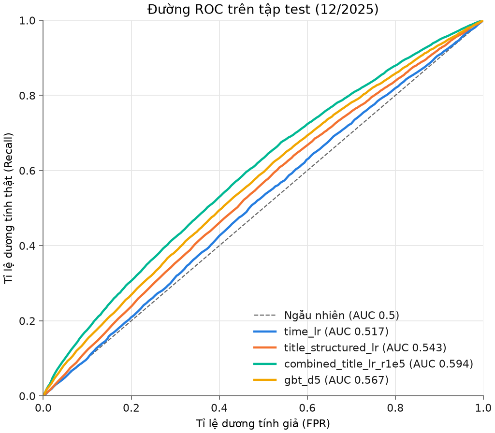
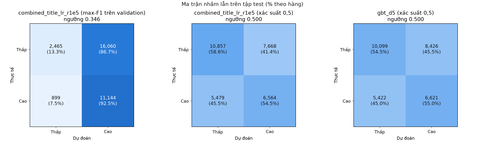
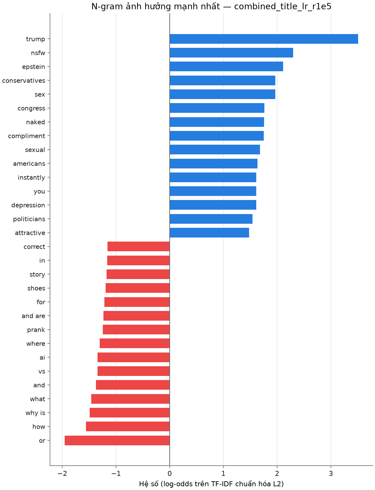
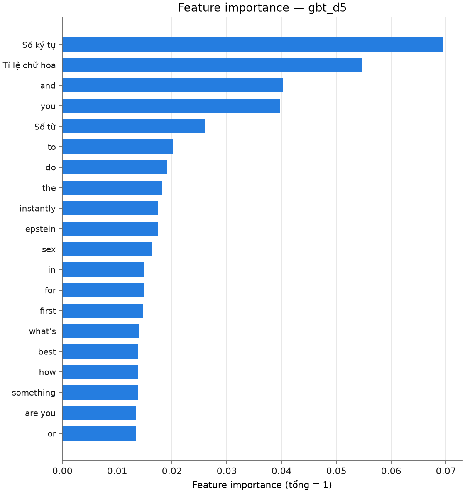
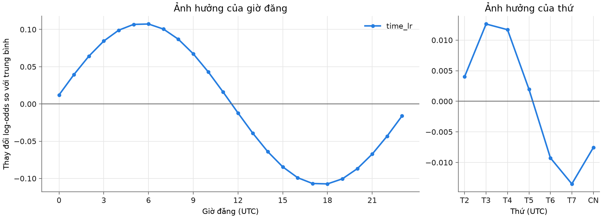

# Kết quả bài toán nhị phân — run `binary_20261125_v4`

Báo cáo sinh tự động bằng `python -m askreddit.binary_report` từ các file JSON cùng thư mục.

> **Công bố:** Cấu hình v4 thiết kế ngày 2026-11-25 sau khi xem kết quả validation của run binary_20261125_v3 (không dùng test v3 cho quyết định này). v3 cho thấy các n-gram chi-square mạnh nhất (i, my, me, why, do i) đánh dấu bài vi phạm luật r/AskReddit và nhiều khả năng bị gỡ, nên nhóm score ≤ 1 trộn lẫn bài bị gỡ với bài ít được quan tâm; và thời điểm đăng đứng riêng chỉ có tín hiệu yếu (AUC validation 0.546). Vì vậy v4 (1) chỉ xét bài có score ≥ 2, đúng phần mà Fang và cộng sự (2016) và Chua (2021) dùng để tính trung vị, với thấp = dưới trung vị và cao = nhóm 25% cao nhất của tập này; (2) bỏ giờ/thứ đăng khỏi mọi mô hình dự đoán, chỉ giữ một mô hình ablation dùng riêng thời gian. Tháng test 12/2025 đã được dùng để chấm v1, v2 và v3, nên test của v4 không còn là hold-out hoàn toàn chưa nhìn thấy; mô hình vẫn chỉ được chọn bằng validation.

## 1. Gán nhãn (chỉ dùng tập train)

- Tập tính phân vị: **train posts with score >= 2**. Trung vị = **3**, phân vị 75% = **4** (Inverse empirical CDF: the smallest train score s with F(s) >= q, from exact integer counts.). DuckDB kiểm tra độc lập: **passed**.
- **Phổ biến cao:** score >= 4 (p75 of train posts with score >= 2). **Phổ biến thấp:** score < 3 (median of train posts with score >= 2). Nhóm giữa (và bài ngoài tập tính phân vị, nếu có) bị loại khỏi huấn luyện và đánh giá.
- Trong tập score ≥ 2 của train, trung vị = 3 và p75 = 4. Lấy thấp = score < trung vị (49,1%, gần 50% nhất) và cao = score ≥ p75 (28,7%, gần 25% nhất) — đúng nghĩa đen "dưới trung vị" và "25% cao nhất" trong đề cương.

| Split | Tổng | Loại (ngoài tập) | Thấp | Giữa (loại) | Cao | Tỉ lệ cao trong dữ liệu giữ lại |
| --- | ---: | ---: | ---: | ---: | ---: | ---: |
| test | 134,105 | 94,492 | 18,525 | 9,045 | 12,043 | 39.40% |
| train | 1,299,855 | 928,466 | 182,480 | 82,444 | 106,465 | 36.85% |
| validation | 253,025 | 179,296 | 34,430 | 16,447 | 22,852 | 39.89% |

## 2. Chọn N-gram bằng chi-square (train)

MLlib ChiSquareTest on binary train term presence; top-k by statistic, ties by vocabulary index. Chọn **128** n-gram cho GBT (tỉ lệ cao toàn train: 36.85%).

| Hạng | N-gram | Chi² | Số bài train | Tỉ lệ cao khi có n-gram |
| --- | ---: | ---: | ---: | ---: |
| 1 | `and` | 688 | 39,595 | 30.94% |
| 2 | `or` | 685 | 25,164 | 29.24% |
| 3 | `instantly` | 381 | 2,883 | 54.28% |
| 4 | `how` | 346 | 36,115 | 32.43% |
| 5 | `what’s` | 317 | 48,218 | 40.42% |
| 6 | `trump` | 300 | 930 | 64.19% |
| 7 | `something` | 224 | 20,510 | 41.71% |
| 8 | `that instantly` | 216 | 1,378 | 55.88% |
| 9 | `makes you` | 207 | 3,239 | 48.97% |
| 10 | `with` | 204 | 18,581 | 31.96% |
| 11 | `what’s a` | 194 | 12,664 | 42.69% |
| 12 | `makes` | 190 | 5,525 | 45.70% |
| 13 | `epstein` | 189 | 312 | 74.36% |
| 14 | `the` | 188 | 105,284 | 35.22% |
| 15 | `what’s something` | 186 | 8,405 | 43.93% |

## 3. So sánh mô hình

Chọn mô hình bằng **AUC-ROC trên validation** (10–11/2025). Ngưỡng xác suất của từng mô hình là ngưỡng tối đa F1 lớp cao trên validation, cố định trước khi chấm test (12/2025). Lớp dương = phổ biến cao.

| Mô hình | Họ | Đặc trưng | AUC val | AUC test | PR-AUC test | Ngưỡng | Precision test | Recall test | F1 test |
| --- | ---: | ---: | ---: | ---: | ---: | ---: | ---: | ---: | ---: |
| `majority` | Baseline lớp đa số | — | 0.5000 | 0.5000 | 0.3940 | 0.500 | 0.0000 | 0.0000 | 0.0000 |
| `time_lr` | Logistic Regression (L2) | giờ + thứ (UTC) | 0.5207 | 0.5168 | 0.4031 | 0.472 | 0.3940 | 1.0000 | 0.5653 |
| `title_structured_lr` | Logistic Regression (L2) | độ dài + dấu hỏi + chữ hoa (không thời gian) | 0.5419 | 0.5433 | 0.4231 | 0.252 | 0.3940 | 0.9998 | 0.5653 |
| `text_lr_r1e5` | Logistic Regression (L2) | TF-IDF 1–2-gram | 0.6120 | 0.5932 | 0.4785 | 0.352 | 0.4107 | 0.9191 | 0.5677 |
| `combined_title_lr_r1e4` | Logistic Regression (L2) | TF-IDF + cấu trúc tiêu đề (không thời gian) | 0.6076 | 0.5913 | 0.4750 | 0.368 | 0.4001 | 0.9713 | 0.5667 |
| `combined_title_lr_r1e5` ⭐ | Logistic Regression (L2) | TF-IDF + cấu trúc tiêu đề (không thời gian) | 0.6121 | 0.5940 | 0.4791 | 0.346 | 0.4096 | 0.9254 | 0.5679 |
| `combined_title_lr_r1e6` | Logistic Regression (L2) | TF-IDF + cấu trúc tiêu đề (không thời gian) | 0.6027 | 0.5857 | 0.4710 | 0.291 | 0.4078 | 0.9297 | 0.5670 |
| `gbt_d5` | Gradient Boosted Trees | top-k n-gram (chi-square) + cấu trúc tiêu đề (không thời gian) | 0.5781 | 0.5673 | 0.4529 | 0.353 | 0.3978 | 0.9779 | 0.5655 |
| `gbt_d7` | Gradient Boosted Trees | top-k n-gram (chi-square) + cấu trúc tiêu đề (không thời gian) | 0.5777 | 0.5692 | 0.4531 | 0.257 | 0.3944 | 0.9935 | 0.5647 |

Cùng các mô hình tại **ngưỡng 0,5** — điểm cắt tự nhiên khi huấn luyện với trọng số lớp cân bằng (các số này do mã đánh giá ghi sẵn cho mọi ứng viên, không tính lại sau khi xem test):

| Mô hình | Balanced acc. val | Balanced acc. test | Precision test | Recall test | F1 test | % đoán cao (test) |
| --- | ---: | ---: | ---: | ---: | ---: | ---: |
| `majority` | 0.5000 | 0.5000 | 0.0000 | 0.0000 | 0.0000 | 0.0% |
| `time_lr` | 0.5123 | 0.5164 | 0.4098 | 0.5140 | 0.4560 | 49.4% |
| `title_structured_lr` | 0.5292 | 0.5353 | 0.4219 | 0.6480 | 0.5110 | 60.5% |
| `text_lr_r1e5` | 0.5797 | 0.5654 | 0.4611 | 0.5442 | 0.4992 | 46.5% |
| `combined_title_lr_r1e4` | 0.5763 | 0.5631 | 0.4568 | 0.5564 | 0.5017 | 48.0% |
| `combined_title_lr_r1e5` ⭐ | 0.5807 | 0.5656 | 0.4612 | 0.5450 | 0.4996 | 46.6% |
| `combined_title_lr_r1e6` | 0.5742 | 0.5593 | 0.4543 | 0.5412 | 0.4940 | 46.9% |
| `gbt_d5` | 0.5554 | 0.5475 | 0.4400 | 0.5498 | 0.4888 | 49.2% |
| `gbt_d7` | 0.5576 | 0.5510 | 0.4434 | 0.5545 | 0.4928 | 49.3% |

> **Lưu ý về ngưỡng.** Ngưỡng tối đa F1 trên validation (0.346) gần như đoán "cao" cho mọi bài (recall 0.925): F1 0.5679 chỉ nhỉnh hơn mức luôn đoán cao (0.5653). Khi lớp dương chiếm gần 40% và tín hiệu yếu, F1 tối đa đạt được bằng cách đoán cao gần hết. Vì vậy AUC-ROC/PR-AUC (không phụ thuộc ngưỡng) là thước đo chính, và kết quả phân lớp được đọc tại ngưỡng 0,5. Việc nhấn mạnh ngưỡng 0,5 được quyết định sau khi xem kết quả run này.

Mốc tham chiếu trên test: tỉ lệ lớp cao = 39.40% (= PR-AUC ngẫu nhiên); luôn dự đoán "cao" cho F1 = 0.5653; baseline lớp đa số (luôn "thấp") có AUC 0.5 và F1 = 0.

**Mô hình được chọn:** `combined_title_lr_r1e5`. Tốt nhất mỗi họ: LR = `combined_title_lr_r1e5`, GBT = `gbt_d5`.

Trên 28,032 bài test có tiêu đề chưa từng xuất hiện trong train, `combined_title_lr_r1e5` đạt AUC 0.5916, F1 0.5590 (toàn test: AUC 0.5940, F1 0.5679).

## 4. N-gram quan trọng (hệ số Logistic Regression)

Hệ số của `combined_title_lr_r1e5`; dương = đẩy về phổ biến cao, âm = đẩy về phổ biến thấp. Đây là quan hệ dự đoán, không phải nhân quả.

| Hạng | Đẩy về CAO | Hệ số | Đẩy về THẤP | Hệ số |
| --- | ---: | ---: | ---: | ---: |
| 1 | `trump` | 3.510 | `or` | -1.953 |
| 2 | `nsfw` | 2.297 | `how` | -1.558 |
| 3 | `epstein` | 2.114 | `why is` | -1.489 |
| 4 | `conservatives` | 1.968 | `what` | -1.460 |
| 5 | `sex` | 1.964 | `and` | -1.370 |
| 6 | `congress` | 1.760 | `vs` | -1.346 |
| 7 | `naked` | 1.756 | `ai` | -1.343 |
| 8 | `compliment` | 1.748 | `where` | -1.306 |
| 9 | `sexual` | 1.681 | `prank` | -1.243 |
| 10 | `americans` | 1.634 | `and are` | -1.235 |
| 11 | `instantly` | 1.614 | `for` | -1.214 |
| 12 | `you` | 1.614 | `shoes` | -1.191 |
| 13 | `depression` | 1.610 | `story` | -1.177 |
| 14 | `politicians` | 1.544 | `in` | -1.161 |
| 15 | `attractive` | 1.479 | `correct` | -1.158 |

Hệ số đặc trưng cấu trúc (trên mỗi độ lệch chuẩn train):

| Đặc trưng | Hệ số |
| --- | ---: |
| Số dấu hỏi | -0.0122 |
| Có dấu hỏi | 0.0030 |
| Số ký tự | -0.1887 |
| Số từ | 0.1325 |
| Tỉ lệ chữ hoa | -0.0230 |

## 5. Feature importance (GBT)

`gbt_d5`: đặc trưng cấu trúc chiếm 16.07% tổng importance, riêng giờ/thứ chiếm 0.00%.

| Hạng | Đặc trưng | Importance |
| --- | ---: | ---: |
| 1 | Số ký tự | 0.0695 |
| 2 | Tỉ lệ chữ hoa | 0.0548 |
| 3 | `and` | 0.0402 |
| 4 | `you` | 0.0398 |
| 5 | Số từ | 0.0260 |
| 6 | `to` | 0.0202 |
| 7 | `do` | 0.0192 |
| 8 | `the` | 0.0182 |
| 9 | `instantly` | 0.0174 |
| 10 | `epstein` | 0.0174 |
| 11 | `sex` | 0.0165 |
| 12 | `in` | 0.0148 |
| 13 | `for` | 0.0148 |
| 14 | `first` | 0.0147 |
| 15 | `what’s` | 0.0141 |

## 6. Ảnh hưởng của thời điểm đăng

- `time_lr`: theo giờ, log-odds dao động 0.215 (cao nhất 6h, thấp nhất 18h UTC); theo thứ dao động 0.026 (cao nhất T3, thấp nhất T7).
- Chỉ dùng giờ/thứ: AUC test 0.5168, gần mức ngẫu nhiên 0.5. Thời điểm đăng chỉ có tín hiệu yếu so với nội dung tiêu đề.

## 7. Hạn chế

- Bỏ nhóm giữa (82,444 bài train) làm bài toán dễ hơn thực tế: mô hình không phải phân biệt các bài sát ranh giới.
- Bỏ 928,466 bài train có score ≤ 1: mô hình trả lời câu hỏi "trong các bài đã có tương tác (score ≥ 2), bài nào phổ biến", chưa áp dụng trực tiếp cho một bài vừa đăng chưa biết có bị gỡ hay không.
- Score là giá trị lưu trong archive, không phải score sau một khoảng thời gian cố định; bài bị gỡ có thể mang score thấp.
- Tháng test 12/2025 đã được dùng để chấm các run trước, nên test không còn hoàn toàn chưa nhìn thấy.
- Chưa chạy: trigram, thí nghiệm loại từ dừng, giờ miền Đông Hoa Kỳ (từ vựng hiện tại là 1–2-gram, giữ từ dừng, giờ UTC).
- Chi-square chọn n-gram trên toàn bộ train trước khi huấn luyện GBT; ngưỡng và lựa chọn mô hình chỉ dùng validation.
