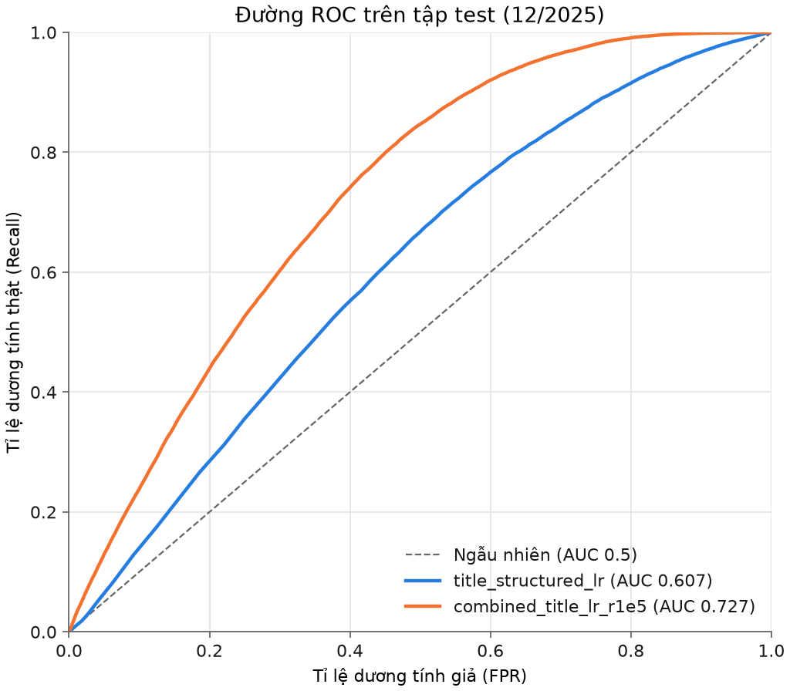
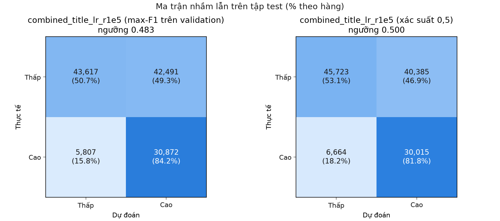
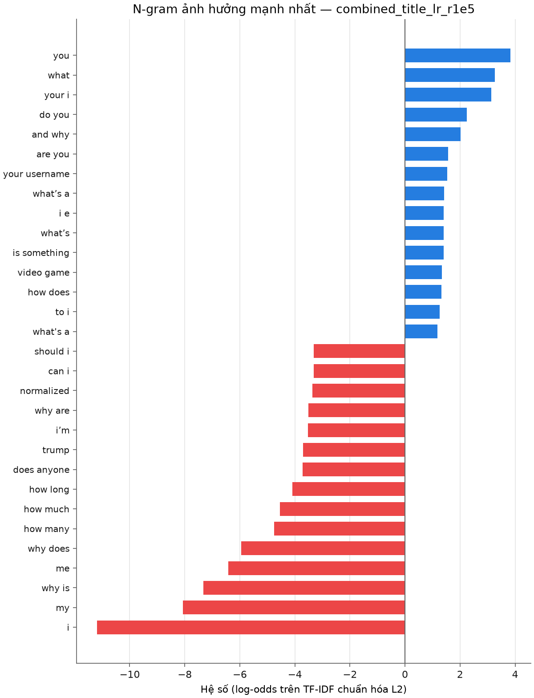

# Kết quả bài toán nhị phân — run `engagement_20261125_v1`

Báo cáo sinh tự động bằng `python -m askreddit.binary_report` từ các file JSON cùng thư mục.

> **Công bố:** Bước 1 của dự đoán score hai bước, thiết kế ngày 2026-11-25. Dự đoán bài có đạt score ≥ 2 hay không (ít nhất một upvote ròng ngoài của tác giả, đo khoảng 36 giờ sau khi đăng theo Arctic Shift), chỉ từ tiêu đề, trên mọi bài của dữ liệu đã bỏ trùng. Nhóm thấp (score ≤ 1) gồm cả bài bị mod gỡ. Xác suất được hiệu chỉnh lại theo tỉ lệ lớp thật khi export. Tháng test 12/2025 đã được dùng ở các run trước.

## 1. Gán nhãn (chỉ dùng tập train)

- Tập tính phân vị: **all train posts**. Trung vị = **1**, phân vị 75% = **2** (Inverse empirical CDF: the smallest train score s with F(s) >= q, from exact integer counts.). DuckDB kiểm tra độc lập: **passed**.
- **Phổ biến cao:** score >= 2 (fixed). **Phổ biến thấp:** score <= 1 (fixed). Nhóm giữa (và bài ngoài tập tính phân vị, nếu có) bị loại khỏi huấn luyện và đánh giá.
- Ngưỡng cố định: cao = bài có ít nhất một upvote ròng (score ≥ 2), thấp = score ≤ 1. Không bỏ nhóm giữa.

| Split | Tổng | Loại (ngoài tập) | Thấp | Giữa (loại) | Cao | Tỉ lệ cao trong dữ liệu giữ lại |
| --- | ---: | ---: | ---: | ---: | ---: | ---: |
| test | 122,787 | 0 | 86,108 | 0 | 36,679 | 29.87% |
| train | 1,203,860 | 0 | 858,185 | 0 | 345,675 | 28.71% |
| validation | 232,113 | 0 | 164,016 | 0 | 68,097 | 29.34% |

## 2. Chọn N-gram bằng chi-square (train)

MLlib ChiSquareTest on binary train term presence; top-k by statistic, ties by vocabulary index. Chọn **128** n-gram cho GBT (tỉ lệ cao toàn train: 28.71%).

| Hạng | N-gram | Chi² | Số bài train | Tỉ lệ cao khi có n-gram |
| --- | ---: | ---: | ---: | ---: |
| 1 | `i` | 42,036 | 106,343 | 1.55% |
| 2 | `my` | 20,287 | 51,597 | 0.96% |
| 3 | `you` | 18,970 | 572,461 | 34.68% |
| 4 | `why` | 15,273 | 148,626 | 15.14% |
| 5 | `what’s` | 12,672 | 129,117 | 42.11% |
| 6 | `me` | 10,273 | 27,977 | 1.62% |
| 7 | `how` | 8,834 | 217,434 | 20.46% |
| 8 | `do i` | 8,773 | 22,017 | 0.42% |
| 9 | `can` | 7,173 | 68,801 | 14.53% |
| 10 | `can i` | 7,075 | 17,816 | 0.42% |
| 11 | `what` | 6,965 | 544,573 | 32.50% |
| 12 | `your` | 6,887 | 268,703 | 35.10% |
| 13 | `why do` | 6,564 | 27,938 | 7.04% |
| 14 | `thing` | 6,040 | 65,356 | 42.09% |
| 15 | `and` | 5,577 | 223,488 | 22.26% |

## 3. So sánh mô hình

Chọn mô hình bằng **AUC-ROC trên validation** (10–11/2025). Ngưỡng xác suất của từng mô hình là ngưỡng tối đa F1 lớp cao trên validation, cố định trước khi chấm test (12/2025). Lớp dương = phổ biến cao.

| Mô hình | Họ | Đặc trưng | AUC val | AUC test | PR-AUC test | Ngưỡng | Precision test | Recall test | F1 test |
| --- | ---: | ---: | ---: | ---: | ---: | ---: | ---: | ---: | ---: |
| `majority` | Baseline lớp đa số | — | 0.5000 | 0.5000 | 0.2987 | 0.500 | 0.0000 | 0.0000 | 0.0000 |
| `title_structured_lr` | Logistic Regression (L2) | độ dài + dấu hỏi + chữ hoa (không thời gian) | 0.6211 | 0.6070 | 0.3588 | 0.475 | 0.3468 | 0.8041 | 0.4846 |
| `combined_title_lr_r1e4` | Logistic Regression (L2) | TF-IDF + cấu trúc tiêu đề (không thời gian) | 0.7314 | 0.7133 | 0.4568 | 0.501 | 0.4190 | 0.7921 | 0.5481 |
| `combined_title_lr_r1e5` ⭐ | Logistic Regression (L2) | TF-IDF + cấu trúc tiêu đề (không thời gian) | 0.7450 | 0.7267 | 0.4695 | 0.483 | 0.4208 | 0.8417 | 0.5611 |

Cùng các mô hình tại **ngưỡng 0,5** — điểm cắt tự nhiên khi huấn luyện với trọng số lớp cân bằng (các số này do mã đánh giá ghi sẵn cho mọi ứng viên, không tính lại sau khi xem test):

| Mô hình | Balanced acc. val | Balanced acc. test | Precision test | Recall test | F1 test | % đoán cao (test) |
| --- | ---: | ---: | ---: | ---: | ---: | ---: |
| `majority` | 0.5000 | 0.5000 | 0.0000 | 0.0000 | 0.0000 | 0.0% |
| `title_structured_lr` | 0.5969 | 0.5844 | 0.3552 | 0.7440 | 0.4808 | 62.6% |
| `combined_title_lr_r1e4` | 0.6764 | 0.6624 | 0.4188 | 0.7943 | 0.5484 | 56.7% |
| `combined_title_lr_r1e5` ⭐ | 0.6882 | 0.6747 | 0.4263 | 0.8183 | 0.5606 | 57.3% |

Mốc tham chiếu trên test: tỉ lệ lớp cao = 29.87% (= PR-AUC ngẫu nhiên); luôn dự đoán "cao" cho F1 = 0.4600; baseline lớp đa số (luôn "thấp") có AUC 0.5 và F1 = 0.

**Mô hình được chọn:** `combined_title_lr_r1e5`. Tốt nhất mỗi họ: LR = `combined_title_lr_r1e5`, GBT = `None`.

Trên 122,787 bài test có tiêu đề chưa từng xuất hiện trong train, `combined_title_lr_r1e5` đạt AUC 0.7267, F1 0.5611 (toàn test: AUC 0.7267, F1 0.5611).

## 4. N-gram quan trọng (hệ số Logistic Regression)

Hệ số của `combined_title_lr_r1e5`; dương = đẩy về phổ biến cao, âm = đẩy về phổ biến thấp. Đây là quan hệ dự đoán, không phải nhân quả.

| Hạng | Đẩy về CAO | Hệ số | Đẩy về THẤP | Hệ số |
| --- | ---: | ---: | ---: | ---: |
| 1 | `you` | 3.828 | `i` | -11.183 |
| 2 | `what` | 3.265 | `my` | -8.075 |
| 3 | `your i` | 3.139 | `why is` | -7.325 |
| 4 | `do you` | 2.239 | `me` | -6.425 |
| 5 | `and why` | 2.016 | `why does` | -5.954 |
| 6 | `are you` | 1.566 | `how many` | -4.759 |
| 7 | `your username` | 1.542 | `how much` | -4.539 |
| 8 | `what’s a` | 1.416 | `how long` | -4.099 |
| 9 | `i e` | 1.406 | `does anyone` | -3.713 |
| 10 | `what’s` | 1.406 | `trump` | -3.703 |
| 11 | `is something` | 1.399 | `i’m` | -3.527 |
| 12 | `video game` | 1.334 | `why are` | -3.504 |
| 13 | `how does` | 1.318 | `normalized` | -3.362 |
| 14 | `to i` | 1.256 | `can i` | -3.318 |
| 15 | `what's a` | 1.185 | `should i` | -3.313 |

Hệ số đặc trưng cấu trúc (trên mỗi độ lệch chuẩn train):

| Đặc trưng | Hệ số |
| --- | ---: |
| Số dấu hỏi | 0.0030 |
| Có dấu hỏi | 0.1469 |
| Số ký tự | -0.1914 |
| Số từ | -0.0665 |
| Tỉ lệ chữ hoa | -0.1783 |

## 7. Hạn chế

- Bỏ nhóm giữa (0 bài train) làm bài toán dễ hơn thực tế: mô hình không phải phân biệt các bài sát ranh giới.
- Score là giá trị lưu trong archive, không phải score sau một khoảng thời gian cố định; bài bị gỡ có thể mang score thấp.
- Tháng test 12/2025 đã được dùng để chấm các run trước, nên test không còn hoàn toàn chưa nhìn thấy.
- Chưa chạy: trigram, thí nghiệm loại từ dừng, giờ miền Đông Hoa Kỳ (từ vựng hiện tại là 1–2-gram, giữ từ dừng, giờ UTC).
- Chi-square chọn n-gram trên toàn bộ train trước khi huấn luyện GBT; ngưỡng và lựa chọn mô hình chỉ dùng validation.
