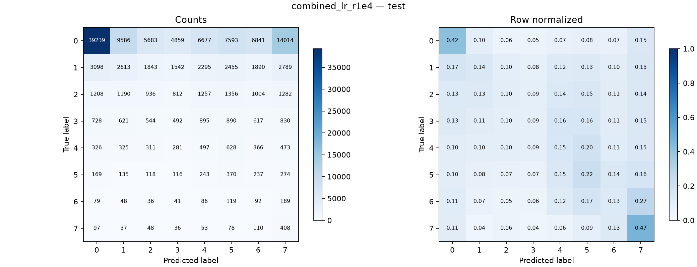

# Kết quả dự đoán tám mức độ phổ biến của bài đăng AskReddit

Thí nghiệm đã chạy trên toàn bộ 1,686,985 bài đã làm sạch. Mô hình được chọn bằng macro-F1 tám lớp trên validation: **combined_lr_r1e4**. Trên test, macro-F1 đạt **0.1327**, balanced accuracy **0.2161**, accuracy **0.3329**.

> **Lưu ý:** Cấu hình v2 được thiết kế ngày 2026-11-25 sau khi đã xem kết quả validation VÀ test của run fang_chua_20261121_v1. v2 chỉ đổi trọng số lớp (alpha=1 cho mọi ứng viên), lưới regParam và giới hạn vòng lặp, và thêm ablation chỉ dùng đặc trưng cấu trúc. Nhãn, split và đặc trưng giống hệt v1. Mô hình vẫn được chọn chỉ bằng macro-F1 validation; tuy vậy test của v2 không còn là hold-out hoàn toàn chưa nhìn thấy theo nghĩa chặt.

## Phương pháp và phạm vi diễn giải

Quy tắc nhãn lấy từ [Fang, Cheng và Ostendorf (2016), mục 3](https://aclanthology.org/W16-6209.pdf), được [Chua (2021), mục 4.2](https://aclanthology.org/2021.acl-srw.10.pdf) sử dụng lại: score ≤ 1 thuộc lớp 0; dùng sáu median liên tiếp của phần dư phía trên để tạo lớp 1–6, phần cuối thuộc lớp 7. Giá trị bằng nhau luôn có cùng nhãn. Metric mean_threshold_f1 là trung bình bảy binary F1 tại các ngưỡng nhãn ≥ 1,…,7; nó khác macro-F1 tám lớp.

Chia thời gian, fit ngưỡng và tiền xử lý chỉ trên train, TF-IDF, LR/RF, cách làm trơn trọng số và chọn mô hình là thiết kế của dự án. Fang nghiên cứu comments và có dùng ngữ cảnh phản hồi về sau; dự án này chỉ dùng title và thời điểm đăng của submissions. Target là score ghi trong archive, không phải score sau 24 giờ. Không có metadata thời điểm quan sát score để xác lập cùng một khoảng tích lũy cho mọi bài. Kết quả dự đoán không chứng minh quan hệ nhân quả của cách đặt tiêu đề hay giờ đăng.

## Dữ liệu và nhãn thực tế

Các khoảng UTC là nửa kín: train [2025-01-01, 2025-10-01), validation [2025-10-01, 2025-12-01), test [2025-12-01, 2026-01-01). Không chia ngẫu nhiên, không loại bài trùng tiêu đề qua các split.

Median train chính xác: **3, 4, 6, 11, 46, 271**. Các biên nguyên: **[2, 3, 4, 6, 11, 46, 271]**. DuckDB đã kiểm chứng độc lập median và số lượng từng lớp ở cả ba split.

| Nhãn | Khoảng score | Train | Validation | Test |
| --- | --- | ---: | ---: | ---: |
| 0 | ≤ 1 | 928,466 (71.43%) | 179,296 (70.86%) | 94,492 (70.46%) |
| 1 | 2 | 182,480 (14.04%) | 34,430 (13.61%) | 18,525 (13.81%) |
| 2 | 3 | 82,444 (6.34%) | 16,447 (6.50%) | 9,045 (6.74%) |
| 3 | 4–5 | 49,591 (3.82%) | 10,345 (4.09%) | 5,617 (4.19%) |
| 4 | 6–10 | 27,703 (2.13%) | 6,019 (2.38%) | 3,207 (2.39%) |
| 5 | 11–45 | 14,487 (1.11%) | 3,236 (1.28%) | 1,662 (1.24%) |
| 6 | 46–270 | 7,339 (0.56%) | 1,595 (0.63%) | 690 (0.51%) |
| 7 | ≥ 271 | 7,345 (0.57%) | 1,657 (0.65%) | 867 (0.65%) |
| Tổng | | 1,299,855 | 253,025 | 134,105 |

Có 5,672 tiêu đề chuẩn hóa chung giữa train và test, tương ứng 8,443 bài test. Tập test chưa thấy tiêu đề trong train gồm 125,662 bài.

## So sánh mô hình

Trọng số train tỷ lệ với `(N/(8*n_k))**alpha` và được chuẩn hóa để trung bình trên bản ghi train bằng 1. Validation/test giữ tần suất tự nhiên; không áp dụng trọng số train vào metric. Chọn macro-F1 validation lớn nhất, làm tròn 12 chữ số rồi xử lý hòa bằng ID ứng viên tăng dần. Lựa chọn đã được ghi cố định trước khi dự đoán test; các kết quả test không thay đổi lựa chọn.

### Validation

| Mô hình | Macro-F1 | Balanced acc. | Accuracy | Weighted-F1 | Mean threshold F1 |
| --- | ---: | ---: | ---: | ---: | ---: |
| majority | 0.1037 | 0.1250 | 0.7086 | 0.5878 | 0.0000 |
| time_lr | 0.0319 | 0.1435 | 0.0223 | 0.0100 | 0.1525 |
| structured_lr | 0.0889 | 0.1764 | 0.2240 | 0.3126 | 0.1661 |
| text_lr_r1e2 | 0.1369 | 0.2070 | 0.4402 | 0.5065 | 0.1955 |
| text_lr_r1e3 | 0.1389 | 0.2154 | 0.4223 | 0.4970 | 0.1984 |
| text_lr_r1e4 | 0.1431 | 0.2308 | 0.3700 | 0.4638 | 0.2063 |
| combined_lr_r1e2 | 0.0793 | 0.1747 | 0.1883 | 0.2718 | 0.1653 |
| combined_lr_r1e3 | 0.1126 | 0.2070 | 0.2788 | 0.3766 | 0.1843 |
| **combined_lr_r1e4** | 0.1433 | 0.2374 | 0.3555 | 0.4523 | 0.2060 |
| rf_weighted | 0.1048 | 0.1906 | 0.2804 | 0.3810 | 0.1831 |

### Test sau khi chốt lựa chọn

| Mô hình | Macro-F1 | Balanced acc. | Accuracy | Weighted-F1 | Mean threshold F1 |
| --- | ---: | ---: | ---: | ---: | ---: |
| majority | 0.1033 | 0.1250 | 0.7046 | 0.5825 | 0.0000 |
| time_lr | 0.0304 | 0.1374 | 0.0212 | 0.0097 | 0.1520 |
| structured_lr | 0.0827 | 0.1598 | 0.2088 | 0.2953 | 0.1634 |
| text_lr_r1e2 | 0.1285 | 0.1967 | 0.4187 | 0.4891 | 0.1888 |
| text_lr_r1e3 | 0.1309 | 0.2029 | 0.4019 | 0.4804 | 0.1916 |
| text_lr_r1e4 | 0.1333 | 0.2122 | 0.3490 | 0.4442 | 0.1973 |
| combined_lr_r1e2 | 0.0741 | 0.1663 | 0.1746 | 0.2546 | 0.1630 |
| combined_lr_r1e3 | 0.1034 | 0.1864 | 0.2585 | 0.3550 | 0.1785 |
| **combined_lr_r1e4** | 0.1327 | 0.2161 | 0.3329 | 0.4307 | 0.1972 |
| rf_weighted | 0.0987 | 0.1769 | 0.2620 | 0.3620 | 0.1789 |

So với baseline lớp phổ biến nhất, macro-F1 test thay đổi từ 0.1033 thành 0.1327, còn accuracy thay đổi từ 70.46% thành 33.29%. Đây là đánh đổi theo tiêu chí macro-F1 đã đăng ký, không phải cải thiện đồng thời mọi metric. Chất lượng phân biệt tám lớp vẫn thấp. Việc một số cấu hình chỉ dự đoán lớp 0 không chứng minh title hoặc thời điểm đăng không có tín hiệu dự đoán.

### Chi tiết từng lớp của mô hình được chọn trên test

| Nhãn | Precision | Recall | F1 | Support |
| --- | ---: | ---: | ---: | ---: |
| 0 | 0.8731 | 0.4153 | 0.5628 | 94,492 |
| 1 | 0.1795 | 0.1411 | 0.1580 | 18,525 |
| 2 | 0.0983 | 0.1035 | 0.1008 | 9,045 |
| 3 | 0.0602 | 0.0876 | 0.0713 | 5,617 |
| 4 | 0.0414 | 0.1550 | 0.0654 | 3,207 |
| 5 | 0.0274 | 0.2226 | 0.0488 | 1,662 |
| 6 | 0.0082 | 0.1333 | 0.0155 | 690 |
| 7 | 0.0201 | 0.4706 | 0.0386 | 867 |

Với mô hình đã chọn, tập con tiêu đề chưa thấy trong train đạt macro-F1 **0.1337**, balanced accuracy **0.2146**, accuracy **0.3451**, weighted-F1 **0.4432**, mean_threshold_f1 **0.1936**.

Precision, recall, F1 và support từng lớp, cùng hai dạng confusion matrix, nằm trong JSON của mỗi mô hình. Mọi macro average dùng đủ tám lớp; các phép chia không xác định đóng góp 0.



## Tài nguyên và kiểm tra

Fit tiền xử lý mất 94.25 giây. Số chiều: {'combined_features': 12009, 'rf_features': 137, 'structured_features': 9, 'text_features': 12000, 'time_features': 4}. Mô hình được chọn huấn luyện trên 1,299,855 bản ghi train.

| Mô hình | Thời gian train (giây) | Số chiều | Chạm giới hạn vòng lặp LR |
| --- | ---: | ---: | --- |
| majority | 0.00 | 0 | N/A |
| time_lr | 5.39 | 4 | False |
| structured_lr | 18.06 | 9 | False |
| text_lr_r1e2 | 111.90 | 12000 | False |
| text_lr_r1e3 | 108.82 | 12000 | False |
| text_lr_r1e4 | 106.08 | 12000 | False |
| combined_lr_r1e2 | 466.14 | 12009 | True |
| combined_lr_r1e3 | 439.36 | 12009 | True |
| combined_lr_r1e4 | 448.55 | 12009 | False |
| rf_weighted | 25.21 | 137 | N/A |

Thời gian biến đổi và ghi đặc trưng theo split: test: 11.99 giây; train: 84.36 giây; validation: 18.48 giây.

Đã qua kiểm tra schema/trường bắt buộc, ID duy nhất trong và giữa split, biên UTC, nhãn theo score nhất quán, đối soát số lượng, median/count độc lập, train-only preprocessing, loại score khỏi danh sách đặc trưng và định nghĩa hai metric F1. Các estimator đều nhận toàn bộ train; RF dùng bagging nội bộ đã khai báo. SHA-256 đầu vào không thay đổi.

Máy có khoảng 8 GB RAM; Spark chạy local[2] với heap 2 GB, cache/spill trên đĩa. Từ vựng và RF được giới hạn trong cấu hình. Các mô hình LR chạm giới hạn vòng lặp, nếu có, được đánh dấu ở bảng trên; không coi đó là bằng chứng đã hội tụ. PyArrow/SciPy không cần cho đường xử lý này. Không cài đặt hay tải dữ liệu, thư viện, hoặc mô hình pretrained.

Runtime báo không tải được native `libblas.so.3`, nhưng Spark vẫn hoàn tất bằng đường xử lý có sẵn. Nếu muốn bổ sung tăng tốc native trên Arch Linux, lệnh thủ công tùy chọn là `sudo pacman -S blas`; lệnh này chưa được chạy và không cần để tái lập đường xử lý hiện tại.

## Kết quả lưu và lệnh tái lập

Dữ liệu nhãn/đặc trưng: `data/experiments/fang_chua_20261125_v2/`. Tiền xử lý/mô hình: `artifacts/experiments/fang_chua_20261125_v2/`. Các bảng đầy đủ: [model_comparison.csv](model_comparison.csv), [class_distributions.json](class_distributions.json), [label_boundaries.json](label_boundaries.json), [selection.json](selection.json).

```bash
JAVA_HOME=/usr/lib/jvm/java-21-openjdk SPARK_LOCAL_IP=127.0.0.1 PYTHONPATH=src \
  .venv/bin/python -m askreddit.experiment \
  --config configs/fang_chua_v2.json --run-id fang_chua_reproduction

PYTHONPATH=src .venv/bin/python -m askreddit.report_results \
  --run-id fang_chua_reproduction
```

Dùng run ID mới cho một lần chạy mới; dùng `--resume` chỉ khi cần tái sử dụng các artifact đã được xác minh tương thích.
