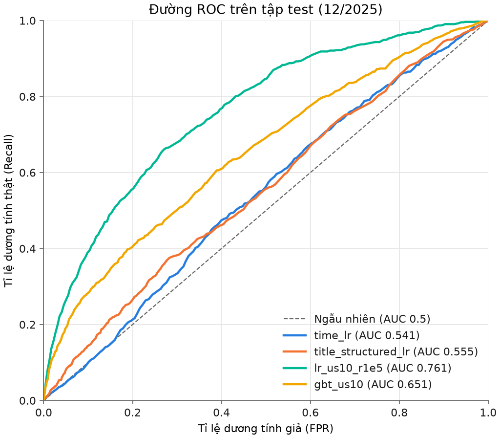
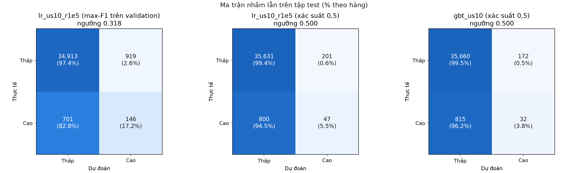
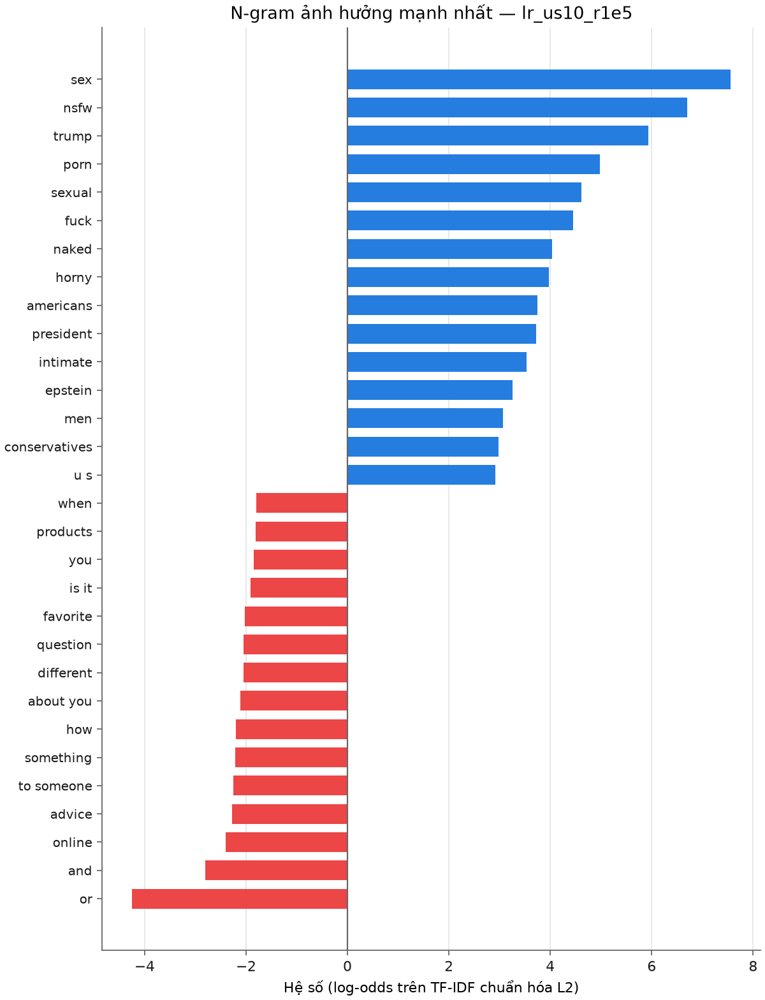
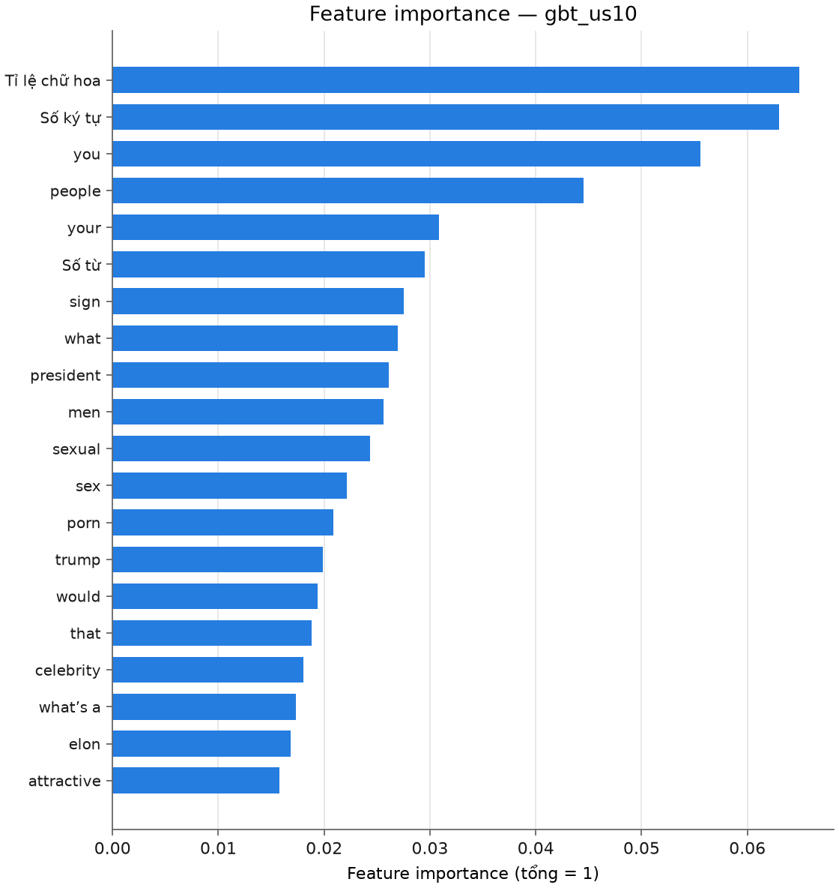
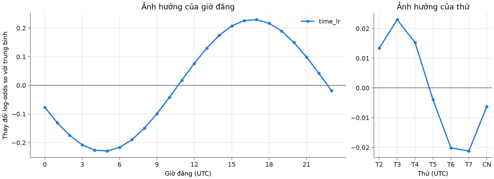

# Kết quả bài toán nhị phân — run `viral_20261126_v1`

Báo cáo sinh tự động bằng `python -m askreddit.binary_report` từ các file JSON cùng thư mục.

> **Công bố:** Cấu hình viral thiết kế ngày 2026-11-26, sau khi đã xem kết quả (kể cả test) của các run nhị phân v3–v5 và mô hình hồi quy. Cao = viral (score ≥ 271, mốc mức 7 của run tám mức v2, tính trên train), thấp = mọi bài còn lại có score ≥ 2 (bộ lọc của Weissburg và cộng sự 2022); không bỏ nhóm giữa. Mô hình chỉ dùng tiêu đề, trên dữ liệu đã bỏ trùng. Mất cân bằng (~2% viral) được xử lý bằng trọng số lớp hoặc undersampling ngẫu nhiên lớp thấp CHỈ trên train (chia tầng theo tháng, seed cố định); validation và test giữ phân phối thật. Xác suất được hiệu chỉnh lại. Chọn mô hình bằng PR-AUC trên validation. Tháng test 12/2025 đã được dùng ở các run trước.

## 1. Gán nhãn (chỉ dùng tập train)

- Tập tính phân vị: **train posts with score >= 2**. Trung vị = **3**, phân vị 75% = **4** (Inverse empirical CDF: the smallest train score s with F(s) >= q, from exact integer counts.). DuckDB kiểm tra độc lập: **passed**.
- **Phổ biến cao:** score >= 271 (fixed). **Phổ biến thấp:** score <= 270 (fixed). Nhóm giữa (và bài ngoài tập tính phân vị, nếu có) bị loại khỏi huấn luyện và đánh giá.
- Cao = viral: score ≥ 271 (mốc mức 7 trong phần tám mức, tính trên train). Thấp = các bài có tương tác còn lại (score 2–270). Đề cương cho phép chuyển sang ngưỡng cố định khi score tập trung; nhãn "cao" giờ mang nghĩa phổ biến thật.

| Split | Tổng | Loại (ngoài tập) | Thấp | Giữa (loại) | Cao | Tỉ lệ cao trong dữ liệu giữ lại |
| --- | ---: | ---: | ---: | ---: | ---: | ---: |
| test | 122,787 | 86,108 | 35,832 | 0 | 847 | 2.31% |
| train | 1,203,860 | 858,185 | 338,497 | 0 | 7,178 | 2.08% |
| validation | 232,113 | 164,016 | 66,478 | 0 | 1,619 | 2.38% |

## 2. Chọn N-gram bằng chi-square (train)

MLlib ChiSquareTest on binary train term presence; top-k by statistic, ties by vocabulary index. Chọn **128** n-gram cho GBT (tỉ lệ cao toàn train: 2.08%).

| Hạng | N-gram | Chi² | Số bài train | Tỉ lệ cao khi có n-gram |
| --- | ---: | ---: | ---: | ---: |
| 1 | `trump` | 4,568 | 1,017 | 32.25% |
| 2 | `epstein` | 1,865 | 337 | 35.61% |
| 3 | `epstein files` | 1,174 | 169 | 39.64% |
| 4 | `sex` | 1,118 | 1,785 | 13.33% |
| 5 | `the epstein` | 972 | 223 | 31.84% |
| 6 | `nsfw` | 962 | 457 | 22.76% |
| 7 | `files` | 934 | 237 | 30.38% |
| 8 | `americans` | 853 | 985 | 15.33% |
| 9 | `elon` | 785 | 196 | 30.61% |
| 10 | `musk` | 783 | 209 | 29.67% |
| 11 | `trump is` | 763 | 89 | 43.82% |
| 12 | `elon musk` | 748 | 124 | 37.10% |
| 13 | `president` | 686 | 531 | 18.27% |
| 14 | `donald` | 652 | 118 | 35.59% |
| 15 | `conservatives` | 509 | 88 | 36.36% |

## 3. So sánh mô hình

Chọn mô hình bằng **PR-AUC trên validation** (10–11/2025). Cột *Thiết kế* ghi cách xử lý mất cân bằng (trọng số lớp hoặc undersampling lớp thấp chỉ trên train). Ngưỡng xác suất của từng mô hình là ngưỡng tối đa F1 lớp cao trên validation, cố định trước khi chấm test (12/2025). Lớp dương = phổ biến cao.

| Mô hình | Họ | Đặc trưng | Thiết kế | AUC val | PR-AUC val | AUC test | PR-AUC test | Ngưỡng | Precision test | Recall test | F1 test |
| --- | ---: | ---: | ---: | ---: | ---: | ---: | ---: | ---: | ---: | ---: | ---: |
| `majority` | Baseline lớp đa số | — | — | 0.5000 | 0.0238 | 0.5000 | 0.0231 | 0.500 | 0.0000 | 0.0000 | 0.0000 |
| `time_lr` | Logistic Regression (L2) | giờ + thứ (UTC) | balanced weights | 0.5687 | 0.0293 | 0.5413 | 0.0252 | 0.540 | 0.0260 | 0.2668 | 0.0474 |
| `title_structured_lr` | Logistic Regression (L2) | độ dài + dấu hỏi + chữ hoa (không thời gian) | balanced weights | 0.6110 | 0.0454 | 0.5546 | 0.0284 | 0.611 | 0.0359 | 0.1015 | 0.0531 |
| `lr_weighted_r1e4` | Logistic Regression (L2) | TF-IDF + cấu trúc tiêu đề (không thời gian) | balanced weights | 0.7990 | 0.1404 | 0.7561 | 0.0827 | 0.717 | 0.1231 | 0.1724 | 0.1436 |
| `lr_weighted_r1e5` | Logistic Regression (L2) | TF-IDF + cấu trúc tiêu đề (không thời gian) | balanced weights | 0.8027 | 0.1368 | 0.7603 | 0.0864 | 0.766 | 0.1179 | 0.2515 | 0.1605 |
| `lr_us5_r1e4` | Logistic Regression (L2) | TF-IDF + cấu trúc tiêu đề (không thời gian) | undersample 1:5 | 0.7870 | 0.1381 | 0.7428 | 0.0765 | 0.321 | 0.1059 | 0.2019 | 0.1390 |
| `lr_us10_r1e4` | Logistic Regression (L2) | TF-IDF + cấu trúc tiêu đề (không thời gian) | undersample 1:10 | 0.7745 | 0.1297 | 0.7299 | 0.0701 | 0.211 | 0.1198 | 0.1263 | 0.1230 |
| `lr_us20_r1e4` | Logistic Regression (L2) | TF-IDF + cấu trúc tiêu đề (không thời gian) | undersample 1:20 | 0.7561 | 0.1150 | 0.7094 | 0.0603 | 0.111 | 0.0984 | 0.0862 | 0.0919 |
| `lr_us10_r1e5` ⭐ | Logistic Regression (L2) | TF-IDF + cấu trúc tiêu đề (không thời gian) | undersample 1:10 | 0.8043 | 0.1437 | 0.7609 | 0.0860 | 0.318 | 0.1371 | 0.1724 | 0.1527 |
| `gbt_weighted` | Gradient Boosted Trees | top-k n-gram (chi-square) + cấu trúc tiêu đề (không thời gian) | balanced weights | 0.7076 | 0.1039 | 0.6450 | 0.0563 | 0.738 | 0.0966 | 0.1157 | 0.1053 |
| `gbt_us10` | Gradient Boosted Trees | top-k n-gram (chi-square) + cấu trúc tiêu đề (không thời gian) | undersample 1:10 | 0.7207 | 0.1119 | 0.6514 | 0.0583 | 0.277 | 0.1318 | 0.0921 | 0.1084 |

Cùng các mô hình tại **ngưỡng 0,5** — điểm cắt tự nhiên khi huấn luyện với trọng số lớp cân bằng (các số này do mã đánh giá ghi sẵn cho mọi ứng viên, không tính lại sau khi xem test):

| Mô hình | Balanced acc. val | Balanced acc. test | Precision test | Recall test | F1 test | % đoán cao (test) |
| --- | ---: | ---: | ---: | ---: | ---: | ---: |
| `majority` | 0.5000 | 0.5000 | 0.0000 | 0.0000 | 0.0000 | 0.0% |
| `time_lr` | 0.5513 | 0.5304 | 0.0259 | 0.5514 | 0.0494 | 49.2% |
| `title_structured_lr` | 0.5842 | 0.5382 | 0.0280 | 0.4262 | 0.0525 | 35.2% |
| `lr_weighted_r1e4` | 0.7226 | 0.6889 | 0.0579 | 0.6139 | 0.1058 | 24.5% |
| `lr_weighted_r1e5` | 0.7169 | 0.6765 | 0.0630 | 0.5443 | 0.1130 | 19.9% |
| `lr_us5_r1e4` | 0.5478 | 0.5185 | 0.1862 | 0.0413 | 0.0676 | 0.5% |
| `lr_us10_r1e4` | 0.5130 | 0.5016 | 0.1875 | 0.0035 | 0.0070 | 0.0% |
| `lr_us20_r1e4` | 0.5003 | 0.5000 | 0.0000 | 0.0000 | 0.0000 | 0.0% |
| `lr_us10_r1e5` ⭐ | 0.5556 | 0.5249 | 0.1895 | 0.0555 | 0.0858 | 0.7% |
| `gbt_weighted` | 0.6458 | 0.5927 | 0.0391 | 0.4427 | 0.0718 | 26.2% |
| `gbt_us10` | 0.5464 | 0.5165 | 0.1569 | 0.0378 | 0.0609 | 0.6% |

Mốc tham chiếu trên test: tỉ lệ lớp cao = 2.31% (= PR-AUC ngẫu nhiên); luôn dự đoán "cao" cho F1 = 0.0451; baseline lớp đa số (luôn "thấp") có AUC 0.5 và F1 = 0.

**Mô hình được chọn:** `lr_us10_r1e5`. Tốt nhất mỗi họ: LR = `lr_us10_r1e5`, GBT = `gbt_us10`.

Hiệu chỉnh xác suất của `lr_us10_r1e5` trên test (cộng -1.554 vào logit để bỏ ảnh hưởng của trọng số/undersampling): xác suất trung bình 0.0208 so với tỉ lệ thật 0.0231 (trước hiệu chỉnh 0.0820); Brier 0.0220 (trước 0.0291).

Trên 36,679 bài test có tiêu đề chưa từng xuất hiện trong train, `lr_us10_r1e5` đạt AUC 0.7609, F1 0.1527 (toàn test: AUC 0.7609, F1 0.1527).

## 4. N-gram quan trọng (hệ số Logistic Regression)

Hệ số của `lr_us10_r1e5`; dương = đẩy về phổ biến cao, âm = đẩy về phổ biến thấp. Đây là quan hệ dự đoán, không phải nhân quả.

| Hạng | Đẩy về CAO | Hệ số | Đẩy về THẤP | Hệ số |
| --- | ---: | ---: | ---: | ---: |
| 1 | `sex` | 7.560 | `or` | -4.247 |
| 2 | `nsfw` | 6.706 | `and` | -2.802 |
| 3 | `trump` | 5.938 | `online` | -2.404 |
| 4 | `porn` | 4.982 | `advice` | -2.277 |
| 5 | `sexual` | 4.611 | `to someone` | -2.249 |
| 6 | `fuck` | 4.446 | `something` | -2.211 |
| 7 | `naked` | 4.033 | `how` | -2.199 |
| 8 | `horny` | 3.976 | `about you` | -2.118 |
| 9 | `americans` | 3.752 | `different` | -2.049 |
| 10 | `president` | 3.725 | `question` | -2.049 |
| 11 | `intimate` | 3.530 | `favorite` | -2.026 |
| 12 | `epstein` | 3.257 | `is it` | -1.917 |
| 13 | `men` | 3.071 | `you` | -1.847 |
| 14 | `conservatives` | 2.977 | `products` | -1.805 |
| 15 | `u s` | 2.912 | `when` | -1.793 |

Hệ số đặc trưng cấu trúc (trên mỗi độ lệch chuẩn train):

| Đặc trưng | Hệ số |
| --- | ---: |
| Số dấu hỏi | -0.0699 |
| Có dấu hỏi | -0.0241 |
| Số ký tự | 0.4710 |
| Số từ | -0.2408 |
| Tỉ lệ chữ hoa | 0.0885 |

## 5. Feature importance (GBT)

`gbt_us10`: đặc trưng cấu trúc chiếm 16.76% tổng importance, riêng giờ/thứ chiếm 0.00%.

| Hạng | Đặc trưng | Importance |
| --- | ---: | ---: |
| 1 | Tỉ lệ chữ hoa | 0.0649 |
| 2 | Số ký tự | 0.0630 |
| 3 | `you` | 0.0556 |
| 4 | `people` | 0.0445 |
| 5 | `your` | 0.0309 |
| 6 | Số từ | 0.0295 |
| 7 | `sign` | 0.0275 |
| 8 | `what` | 0.0269 |
| 9 | `president` | 0.0261 |
| 10 | `men` | 0.0256 |
| 11 | `sexual` | 0.0244 |
| 12 | `sex` | 0.0222 |
| 13 | `porn` | 0.0209 |
| 14 | `trump` | 0.0199 |
| 15 | `would` | 0.0194 |

## 6. Ảnh hưởng của thời điểm đăng

- `time_lr`: theo giờ, log-odds dao động 0.458 (cao nhất 17h, thấp nhất 5h UTC); theo thứ dao động 0.044 (cao nhất T3, thấp nhất T7).
- Chỉ dùng giờ/thứ: AUC test 0.5413, gần mức ngẫu nhiên 0.5. Thời điểm đăng chỉ có tín hiệu yếu so với nội dung tiêu đề.

## 7. Hạn chế

- Bỏ nhóm giữa (0 bài train) làm bài toán dễ hơn thực tế: mô hình không phải phân biệt các bài sát ranh giới.
- Bỏ 858,185 bài train có score ≤ 1: mô hình trả lời câu hỏi "trong các bài đã có tương tác (score ≥ 2), bài nào phổ biến", chưa áp dụng trực tiếp cho một bài vừa đăng chưa biết có bị gỡ hay không.
- Score là giá trị lưu trong archive, không phải score sau một khoảng thời gian cố định; bài bị gỡ có thể mang score thấp.
- Tháng test 12/2025 đã được dùng để chấm các run trước, nên test không còn hoàn toàn chưa nhìn thấy.
- Chưa chạy: trigram, thí nghiệm loại từ dừng, giờ miền Đông Hoa Kỳ (từ vựng hiện tại là 1–2-gram, giữ từ dừng, giờ UTC).
- Chi-square chọn n-gram trên toàn bộ train trước khi huấn luyện GBT; ngưỡng và lựa chọn mô hình chỉ dùng validation.
